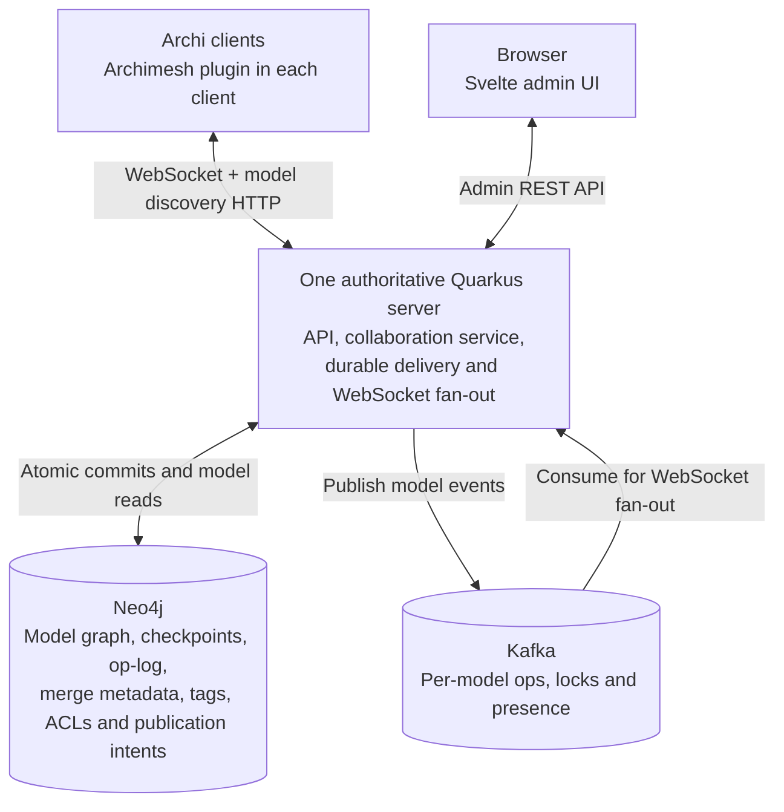
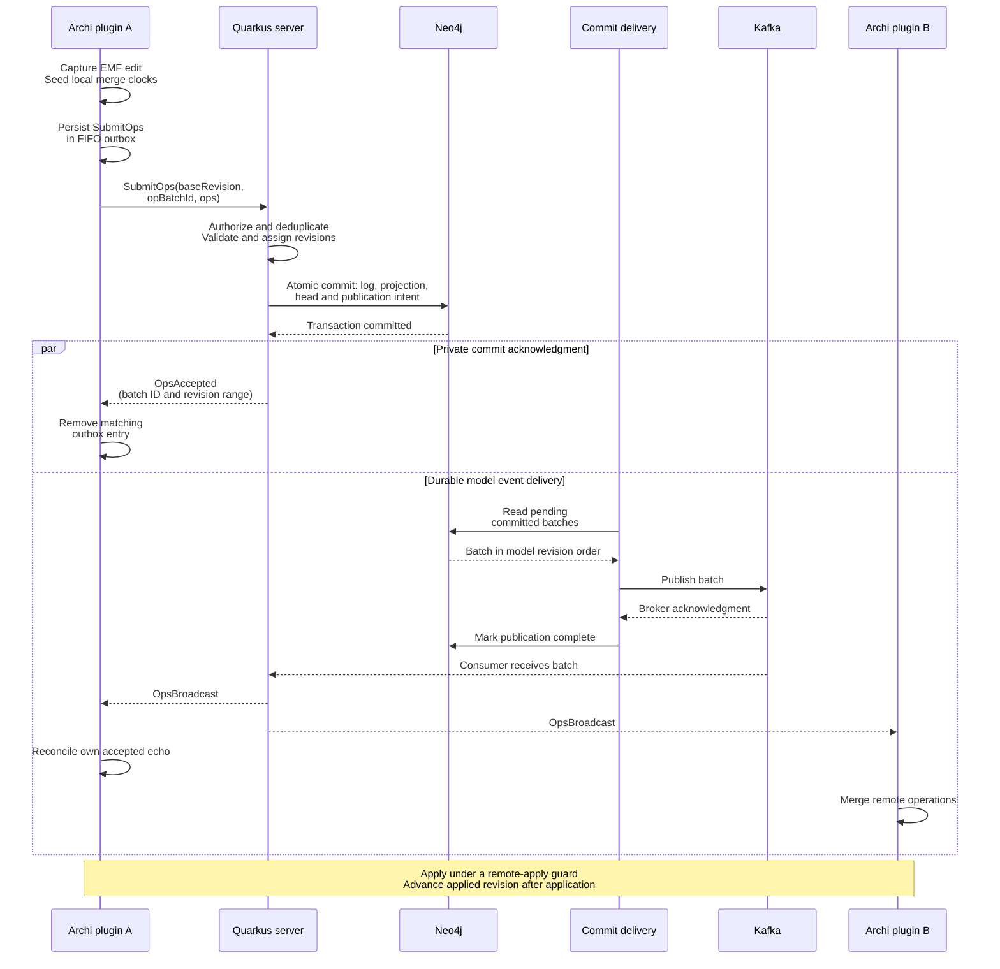

# Archimesh — cooperative modelling in Archi

Archimesh lets multiple users edit a shared ArchiMate model in [Archi](https://www.archimatetool.com/). An Eclipse RCP/EMF plugin captures local semantic, folder, and diagram changes, sends operations to the server, and reconciles accepted changes into each open model.

The architecture combines a **central authoritative timeline** with **CRDT-style merge rules**. Quarkus validates and orders changes, Neo4j stores the durable model and history, and Kafka distributes events. Each model has one writable `HEAD` and immutable, read-only tags.

Start with the overview below, then see [architecture.md](architecture.md) for component wiring, checkout, authorization, timeline, and recovery diagrams. The [CRDT specification](crdt-spec.md) describes merge behavior and its current limits. A longer presentation is available in [the manual](docs/manual/archimesh-manual.pdf).

## Architecture at a glance



Archi clients communicate with Quarkus over WebSocket and HTTP. The server owns the Neo4j and Kafka connections. `OpsAccepted` acknowledges a durable commit to the submitting client; `OpsBroadcast` travels through the Kafka consumer to subscribed clients. Those two deliveries can arrive in either order.

## Components

| Component | Responsibility | Main code |
| --- | --- | --- |
| Archi plugin | Observe EMF changes, map operations, persist pending submissions, restore snapshots, and merge broadcasts into the local model. | [Client workspace](client/README.md); `EmfChangeCapture`, `OpMapper`, `ArchimeshSessionManager`, `RemoteOpApplier` |
| WebSocket and REST endpoints | Decode requests, resolve identity, enforce access, and expose collaboration, model discovery, snapshots, and administration. | [Server](server/README.md); `ArchimeshEndpoint`, `ModelCatalogEndpoint`, `ModelStateEndpoint`, `AdminEndpoint` |
| Collaboration service | Validate model/ref state and references, coordinate locks, deduplicate retries, and assign revision ranges. | [ArchimeshService](server/src/main/java/org/gautelis/archimesh/service/ArchimeshService.java) |
| Neo4j repository | Store the materialized graph, commits/ops, merge clocks, tombstones, tags, ACLs, and pending publication payloads. Commit log, projection, head, and publication intent atomically. | [Repository implementation](server/src/main/java/org/gautelis/archimesh/service/impl/Neo4jRepositoryImpl.java); [graph model](neo4j/graph-model.md) |
| Durable delivery and Kafka fan-out | Retry publication of committed batches, preserve per-model event order, and deliver model events to WebSocket subscribers. | [CommitDeliveryService](server/src/main/java/org/gautelis/archimesh/service/CommitDeliveryService.java), `KafkaPublisherImpl`, `KafkaConsumerImpl`, `SessionRegistry` |
| Admin UI | Manage models, tags, access, sessions, audit views, import/export, and recovery operations through REST. Built as static assets served by Quarkus at `/admin-ui/`. | [admin-web](admin-web/README.md) |

## How an edit reaches other users



For notation changes, the plugin brackets submission with acquire/release lock requests. The server checks ownership and also acquires a short lease for clients that omit the explicit request. Lease ownership is tied to the authenticated WebSocket session.

A failed transaction receives no acceptance. Retrying the same `(modelId, opBatchId)` consults the persisted commit and returns the original revision range. Kafka publication retries survive server restart; duplicate broadcasts are tolerated. Rejections go to the submitting session and include the batch ID so another client's queued work is unaffected.

Delivery rotates through pending models and uses a bounded pool of independent model workers. Each worker publishes a limited ordered prefix and stops at the first failure. A failed or corrupt model retains its pending intent while other models can progress. Defaults are four concurrent models and 25 batches per model visit; see [delivery configuration](server/README.md#durable-operation-delivery).

## Opening, reconnecting, and working offline

1. An administrator provisions the model. Clients discover readable models through `GET /models` and tags through `GET /models/{modelId}/tags`; joining or submitting cannot implicitly create a model.
2. The plugin opens `/models/{modelId}/stream` and sends `Join` with the selected ref and, when trusted local state exists, its last applied revision.
3. A cold join receives a snapshot. A reconnect can receive a complete delta window; an incomplete window or an ahead-of-server revision falls back to a snapshot. Tagged refs always receive their stored historical snapshot.
4. Snapshots restore model entities, folder placement, diagram objects, property values, merge clocks, and tombstones. The client finishes checkout before draining pending submissions.
5. Online and offline submissions remain in the persistent FIFO outbox until matching acceptance. Transport failures retry with capped backoff. Queue capacity preserves existing work; correlated semantic/lock conflicts are surfaced to the user and trigger projection recovery.

The [checkout decision diagram](architecture.md#join--checkout) shows these paths in more detail.

## State, merging, and model history

| State | Owner and purpose |
| --- | --- |
| Local EMF model | The user's editable projection, including optimistic local edits. It becomes consistent with accepted server state through checkout and operation reconciliation. |
| Client outbox | Durable uncommitted intent for a model. A successful WebSocket send does not remove it; matching `OpsAccepted` does. |
| Neo4j model graph and op-log | Authoritative current state and accepted history. Each operation consumes a revision; each accepted batch gets a contiguous range. |
| Kafka topics | Event distribution to connected clients. Committed operations can be delivered more than once and can be recovered from Neo4j. |
| Tags | Immutable named revisions with stored historical snapshots. `HEAD` remains writable; opening a tag is read-only. |

Semantic and notation fields use last-writer-wins (LWW) clocks where supported. Tombstones protect deleted entities from stale recreates, and member-clock operations handle supported collection domains. Incoming causal metadata advances the client's logical clock. Server revisions order accepted history; causal clocks decide field-level merge winners.

Notation updates use `UpdateViewObjectOpaque` and `UpdateConnectionOpaque` payloads containing serialized notation fields. The server validates field names against `NotationMetadata` and merges supported fields individually. See the [notation contract](schemas/notation-contract.md) and [mapping](notation_mapping.md).

## Access and administration

Authorization supports bootstrap identities for local development, trusted proxy headers, and OIDC/JWT identities. When authorization is enabled, model ACLs govern model access and can override generic reader/writer roles. Global admins retain administrative access; catalog filtering lets ordinary users discover the models they may read.

The admin UI/API provides model provisioning, ACL management, immutable tags, active sessions, audit/diagnostic views, package export/import, checkpoint creation, pruning previews, and rebuild. Export packages contain model metadata, ACLs, current state, recovery data, and tag snapshots. Recovery uses either a complete operation log or a checkpoint with prefix acceptance receipts and a complete operation tail. Import rejects an existing model unless overwrite is requested and rejects overwrite while live sessions exist. See [server API and identity setup](server/README.md), [export format](server/EXPORT_FORMAT.md), and the [checkpoint maintenance workflow](docs/checkpoint-pruning.md).

## Reliability and deployment

- Run **one authoritative server per Neo4j repository**. A renewable database writer lease enforces this topology; timeline operations are serialized in the active server.
- Each model's ops topic needs **one Kafka partition** to preserve order. Topic names follow `archimesh.model.<modelId>.<ops|locks|presence>`.
- Operation publication is durable and at least once. Lock/presence events use their own Kafka topics; lock leases and live sessions are process-local state.
- Rebuild verifies the latest checkpoint and complete, contiguous operation tail before replacing the projection in one transaction. Without a checkpoint it requires the full operation history. V2 checkpoint import also restores in one transaction.
- Manual pruning removes only whole, published batches covered by a verified checkpoint and the requested retention policy. It retains acceptance receipts, all clocks, and tombstones. Stale reconnects receive a snapshot when their delta history has been pruned. Archive full history before pruning if individual old operations are needed.
- Scheduled checkpoint creation, payload pruning, and retention of older checkpoints are configurable and disabled by default. The worker rotates through bounded model sets, preserves the newest recovery base, and resumes after failures or restart. See [scheduled maintenance configuration](docs/checkpoint-pruning.md#optional-scheduled-maintenance).

The [architecture document](architecture.md#supported-deployment-and-recovery) includes recovery and publication-failure diagrams, deployment boundaries, and known operational gaps.

## Local development and validation

Use Java 21+, Docker/Compose, and the Archi bundles described in the [client setup](client/README.md). Client builds use the Maven 3.9.16 wrapper in `client/` for Tycho compatibility.

```bash
# Start Neo4j/Kafka, apply the schema, and run Quarkus in the foreground
./scripts/dev-up.sh

# In another terminal, build the Archi plugin
./scripts/build-client-standalone.sh
```

See [dev-setup.md](dev-setup.md) for environment settings, service ports, and manual infrastructure setup. The server defaults to port `8081`; the admin UI is served at `http://localhost:8081/admin-ui/` after [building its assets](admin-web/README.md).

| Command | Coverage |
| --- | --- |
| `./scripts/validate-local.sh fast` | Hardening contract and notation parity checks. |
| `./scripts/validate-local.sh gate` | Fresh plugin build, all client tests, and server unit tests; infrastructure tests skip unless enabled. |
| `./scripts/validate-local.sh infra` | Gate plus local Neo4j/Kafka, REST, and authorization integration coverage. |
| `./scripts/validate-local.sh ws` | Full gate including WebSocket end-to-end coverage. |

These scripts are the supported release gate entrypoints. [The sanity checklist](sanity-checklist.md) covers manual collaboration checks in Archi.

## Repository guide

| Location | Contents |
| --- | --- |
| [architecture.md](architecture.md) | Component wiring, state ownership, identity, checkout, history, and recovery flows. |
| [crdt-spec.md](crdt-spec.md) | Merge rules, implemented domains, correctness expectations, and remaining work. |
| [docs/checkpoint-pruning.md](docs/checkpoint-pruning.md) | Checkpoint creation, bounded payload pruning, recovery, and operational limits. |
| [client/](client/README.md) | Archi plugin, target-platform setup, pinned build, and client tests. |
| [server/](server/README.md) | Quarkus endpoints, services, persistence, identity setup, and server tests. |
| [admin-web/](admin-web/README.md) | Svelte administration UI. |
| [schemas/](schemas/notation-contract.md) | Operation/message schemas and notation contract. |
| [neo4j/](neo4j/graph-model.md) | Graph model and [database constraints/indexes](neo4j/schema.cypher). |
| [kafka/](kafka/kafka.md) | Topic naming and partitioning guidance. |
| [scripts/](scripts/) | Development, packaging, installation, and validation commands. |
| [docs/manual/](docs/manual/archimesh-manual.pdf) | Illustrated project manual, LaTeX/Mermaid sources, and [build instructions](docs/manual/README.md). |

This project was created using Codex, but the process has been highly iterative with a lot of trials, fails and sequential human decisions. I would not have been able to make progress like this without my Codex "team", but I have been along the whole trip.
