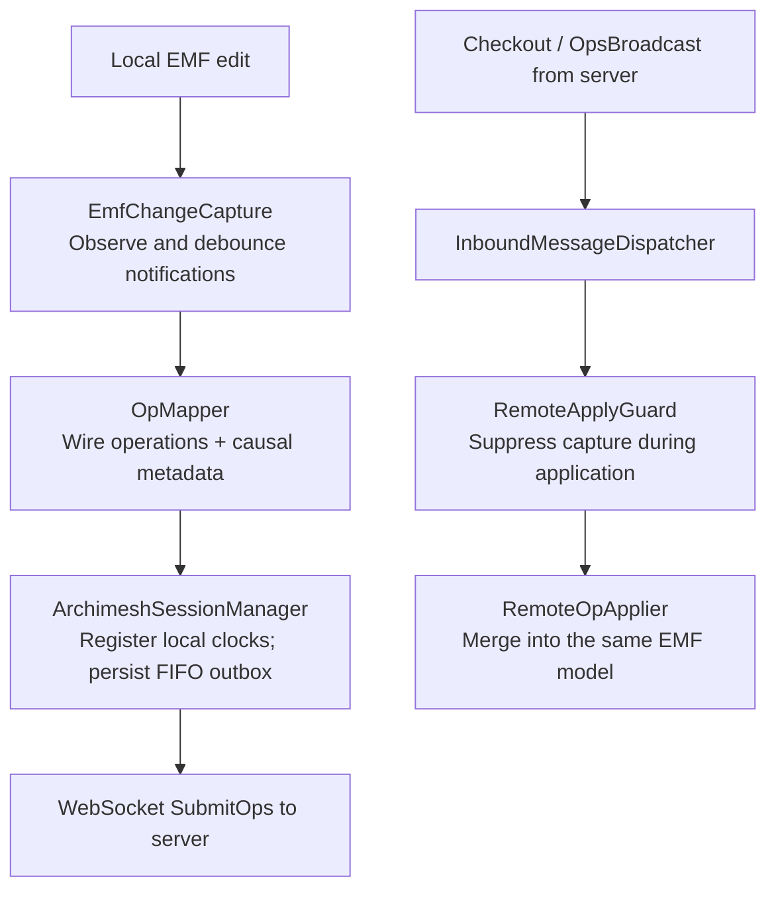
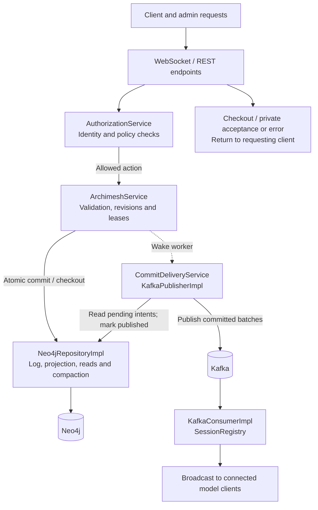
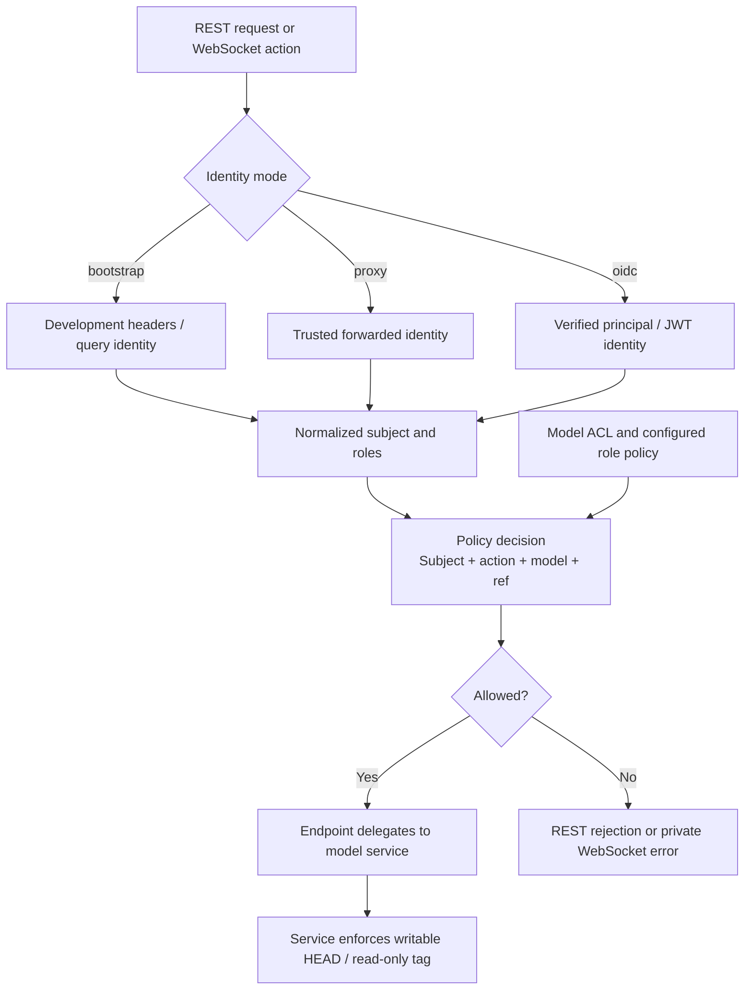
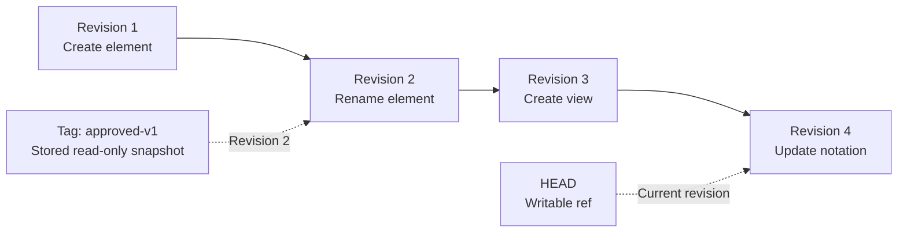
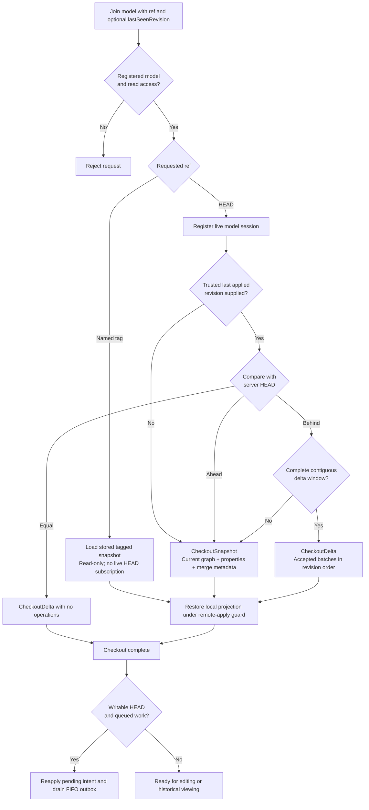
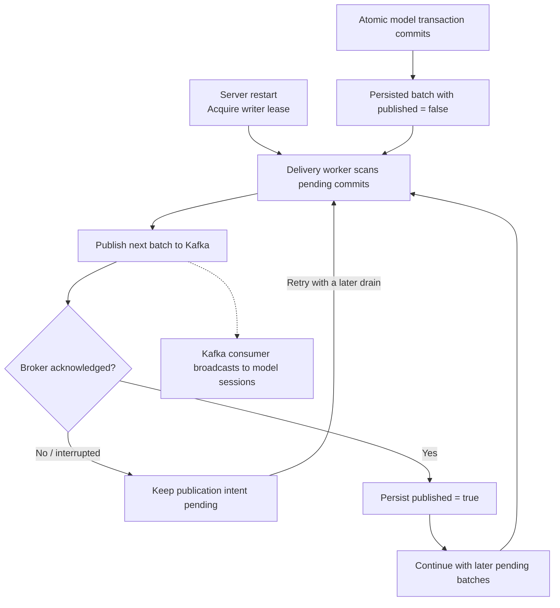
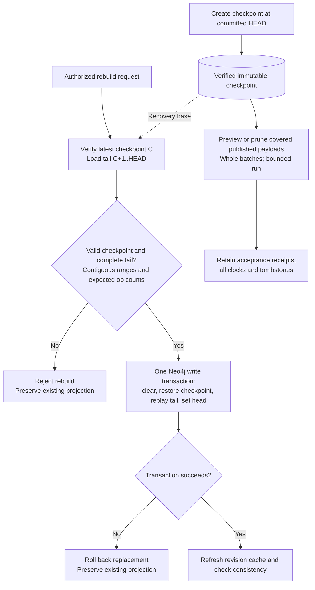

# Architecture

This document explains how the Archimesh solution is structured, where state lives, and how the major flows work. Start with the [README overview](README.md#architecture-at-a-glance) and [edit sequence](README.md#how-an-edit-reaches-other-users) for the system-level view. The diagrams here expand the internal wiring and recovery paths.

## Purpose

The system lets multiple Archi clients collaborate on the same model timeline via Archimesh.

It does this by combining:

- a local Archi client plugin that captures and applies model changes
- a Quarkus Archimesh server that validates, orders, persists, and broadcasts changes
- Kafka for ordered model event fan-out
- Neo4j for the materialized model graph, op-log, tags, and merge metadata

The model is intentionally linear:

- one `HEAD`
- no branches
- immutable tags as named historical points

## System view

At a high level:

1. a user edits a model in Archi
2. the client plugin captures local EMF changes and turns them into Archimesh ops
3. the server validates the op batch and assigns authoritative revisions
4. the server persists the batch, updates the materialized graph, and broadcasts it
5. other clients apply the accepted ops into their local Archi model

There are two kinds of state in play:

- local working state inside each Archi client
- authoritative shared state on the Archimesh server

## Component wiring

The plugin has two paths into the local EMF model: ordinary user edits are captured and sent, while accepted remote operations are applied with capture suppressed. The server separates request handling and durable persistence from asynchronous event publication and WebSocket fan-out.

On the server, request handling, storage, and event distribution are separate components. Private replies return directly to the requester; accepted model events reach live subscribers through the Kafka consumer.

`ArchimeshModelController` attaches and detaches capture when the active model changes. `RemoteApplyGuard` prevents remote application from generating new local submissions. `NotationMetadata` defines server-supported notation fields and their persisted merge clocks; parity checks keep the wire schema and client serializers aligned.

## Main components

## Archi client plugin

Location:

- `client/org.gautelis.archimesh.plugin`

Responsibilities:

- connect to the Archimesh websocket
- capture local semantic and notation edits from EMF
- convert local changes into `SubmitOps`
- maintain a bounded offline outbox
- apply remote snapshots and broadcasts into the local Archi model
- manage local Archimesh session state such as:
  - current model id
  - current ref (`HEAD` or tag)
  - auth token
  - last known revision

Important classes:

- `ArchimeshSessionManager`
  - websocket lifecycle
  - outbox handling
  - join/rejoin decisions
  - local submit tracking
- `EmfChangeCapture`
  - observes local EMF changes
  - maps them to Archimesh operations
- `OpMapper`
  - builds wire-format op batches
- `RemoteOpApplier`
  - applies snapshots and remote broadcasts into the local model
- `ArchimeshModelController`
  - attaches and detaches the Archimesh plumbing from a model

Important client design choices:

- local edits are not immediately authoritative
- `OpsAccepted` from the server is the commit acknowledgment
- local operations seed merge clocks immediately; accepted broadcasts, including the client's own, are reconciled under the remote-apply guard
- tagged refs are read-only in the client
- `Tools > Resynchronize Model` can force a cold snapshot rebuild of the local projection

## Archimesh server

Location:

- `server/src/main/java`

Responsibilities:

- websocket and REST entry points
- authorization
- model registration rules
- validation and precondition checks
- revision assignment
- idempotency
- persistence to Neo4j
- broadcast through Kafka and websocket sessions
- admin export/import, tags, ACLs, and diagnostics

Important entry points:

- `ArchimeshEndpoint`
  - websocket endpoint for join, submit, lock, presence
- `ModelCatalogEndpoint`
  - read-filtered model discovery and tag listing for ordinary clients
- `ModelStateEndpoint`
  - snapshot and rebuild endpoints
- `AdminEndpoint`
  - model catalog, ACL, tags, export/import, audit/diagnostic endpoints

Core service:

- `ArchimeshService`
- `CommitDeliveryService` for durable asynchronous publication

`ArchimeshService` is the central coordination layer. It:

- validates client actions against model and ref state
- assigns revision ranges
- normalizes causal metadata
- prepares batches for persistence
- handles tags, export/import, rebuild, and admin views

## Authorization architecture

Authorization is enforced in Quarkus.

The server uses:

- a Quarkus-side PEP
- a project-specific in-process PDP

The current PDP is intentionally narrow to this domain. It is not generic XACML infrastructure.

### Identity modes

Identity resolution is pluggable:

- `bootstrap`
  - local/dev mode
  - REST: `X-Archimesh-User`, `X-Archimesh-Roles`
  - websocket: `user`, `roles`
- `proxy`
  - trusted forwarded headers from a reverse proxy
- `oidc`
  - direct principal/role resolution through Quarkus auth
  - can use local JWT verification or an external OIDC provider

Role names are normalized into canonical internal roles:

- `admin`
- `model_reader`
- `model_writer`

### Policy model

The PDP decides on actions such as:

- admin catalog actions
- model join
- snapshot read
- submit ops
- locks and presence
- tag actions

Model-scoped ACLs are stored per model and, when configured, override generic reader/writer role checks for that model.

### Authorization request flow

When authorization is enabled, the transport supplies identity and the requested action to the policy layer. Model read/write decisions use model ACLs when configured; otherwise the canonical reader/writer roles apply. Global administrators retain access. Administrative actions have separate catalog-level or model-admin requirements.

`GET /models` filters discovery results with model-read decisions, so a user's ability to open a model does not require global admin access. Authorization-disabled bootstrap development bypasses these policy checks; identity mode and authorization enablement are separate settings.

## Persistence architecture

The server persists to Neo4j using a split repository layer.

Main coordinating repository:

- `Neo4jRepositoryImpl`

Supporting collaborators:

- `Neo4jOpLogSupport`
  - commit/op persistence
- `Neo4jMaterializedStateSupport`
  - materialized graph mutation
  - folder handling
  - notation merge logic
  - tombstones and property clocks
- `Neo4jReadSupport`
  - snapshot export
  - checkout delta reads
  - consistency checks
- `Neo4jCompactionSupport`
  - bounded checkpoint-covered operation payload pruning; retains receipts and merge metadata
- `Neo4jCheckpointSupport`
  - lossless projection capture, checksum validation, and raw graph restoration

Supporting invariant source:

- `NotationMetadata`

This is the shared source of truth for supported notation fields and persisted notation merge metadata.

### What is persisted

Neo4j stores:

- model catalog metadata
- per-model ACL arrays
- materialized current state
- folders and folder memberships
- view hierarchy and diagram notation
- op-log commits and ops
- immutable tags with stored tagged snapshots
- tombstones and property clocks for merge behavior

The current graph structure is documented in:

- `neo4j/graph-model.md`

## Messaging architecture

Kafka is used as the ordered fan-out path for accepted Archimesh batches.

Topic pattern:

- `archimesh.model.<modelId>.ops`
- `archimesh.model.<modelId>.locks`
- `archimesh.model.<modelId>.presence`

Important behavior:

- each model's ops topic must have exactly one partition for total order
- one Neo4j transaction persists the log, projection, head, and pending publication payload
- an ordered durable dispatcher publishes committed batches and retries after broker failures or server restart
- duplicate broadcasts are tolerated; applied revision advances only after projection application
- websocket clients receive broadcasts from the session registry / consumer path

## Data and state model

## Linear model timeline

Every model has one linear revision timeline.

There is:

- one moving `HEAD`
- zero or more immutable tags

There are no branches.

### Revisions

Clients submit a batch against:

- `baseRevision`

The server assigns an authoritative contiguous revision range to the accepted batch:

- `assignedRevisionRange.from`
- `assignedRevisionRange.to`

If the batch contains `N` ops, it consumes `N` revisions.

This range is used for:

- commit history
- rebuild
- export/import
- per-op causal Lamport defaults

## Snapshot vs op-log

The system keeps both:

- a materialized snapshot-like graph in Neo4j
- an accepted op-log whose old payloads can be replaced by durable checkpoints

Why both exist:

- the materialized graph makes joins, exports, and admin inspection fast
- retained acceptance receipts preserve the committed timeline; checkpoints plus the operation tail preserve recovery state

This is why export packages contain:

- current snapshot
- full op batches, or a checkpoint with prefix receipts and a complete operation tail
- tag snapshots

## Tags

Tags are immutable named revision points.

Behavior:

- `HEAD` is writable
- tags are read-only
- pulls/checkouts can target `HEAD` or a tag
- tag snapshots are stored server-side

Tags are part of the model timeline and must survive export/import.

### Timeline and tags

Accepted batches extend one revision timeline. The diagram shows revisions consumed by individual operations; a batch may span several adjacent revisions. A tag names a revision and retains its historical snapshot even as later edits advance `HEAD`.

Revisions describe acceptance order. Per-field causal tuples describe merge precedence. A batch can consume revisions while one of its field updates loses an LWW comparison; the history still records that accepted operation.

## Folders

Model-tree folders are first-class synchronized state.

Important rules:

- root folders have stable synthetic ids
- user folders have immutable ids
- rename is allowed
- object placement in folders is explicit
- cross-root folder moves are rejected
- non-empty folder delete is rejected

This avoids drift between clients and preserves Archi model-tree structure.

## Main flows

## Join / checkout

The requested ref and the trustworthiness of the local projection determine the checkout response. The server checks authorization and model existence before choosing the path.

1. client opens websocket
2. client sends `Join`
3. server resolves:
   - model existence
   - authorization
   - requested ref (`HEAD` or tag)
4. server responds with:
   - `CheckoutSnapshot`, or
   - `CheckoutDelta`
5. client applies snapshot/delta into the local Archi model

Important rule:

- `Connect Archimesh...` and explicit cold-start paths use a snapshot-first rejoin because delta rejoin is unsafe for arbitrary non-server-backed local models

## Edit / submit

The [README sequence diagram](README.md#how-an-edit-reaches-other-users) shows the full request, acknowledgment, and fan-out path.

1. A user changes the local EMF model. `EmfChangeCapture` and `OpMapper` build operations with causal metadata.
2. The plugin registers local merge clocks and persists the submission in its FIFO outbox before sending it. Notation submissions are bracketed by lock acquire/release requests.
3. The endpoint authorizes the action and binds lock ownership to the authenticated WebSocket session. The service checks for an existing durable acceptance before state-dependent preconditions, then validates references/notation, checks leases, and assigns a revision range.
4. One Neo4j transaction appends the commit/ops, updates the materialized graph and head, and stores a pending publication payload. Failure rolls the transaction back and yields no acceptance.
5. The submitting session receives `OpsAccepted` and removes the matching pending entry. The independently scheduled delivery worker publishes committed batches through Kafka and marks publication complete after broker acknowledgment.
6. The Kafka consumer broadcasts to all live subscribers, including the originator. Clients reconcile operations under the remote-apply guard and advance their applied revision after application. A detected revision gap requests catch-up.

The acknowledgment and broadcast may arrive in either order. A durable commit acknowledgment is not evidence that every subscriber has already applied the change. Model/ref errors and submit rejections are private replies; batch-specific rejection messages carry `opBatchId`.

## Offline outbox

The client keeps a bounded persistent outbox per model.

Key guarantees:

- FIFO replay per model
- rebasing to latest known revision before replay send
- every submission is persisted before send and removed only after matching `OpsAccepted`
- transient failures retain intent indefinitely with capped retry backoff
- queue capacity rejects additional submissions instead of evicting existing work
- invalidating a cache projection preserves its outbox
- conflicting stale replay head entries are dropped on:
  - `PRECONDITION_FAILED`
  - `LOCK_CONFLICT`

This is intentionally conservative. The goal is deterministic recovery, not hidden magic.

## Apply remote ops

Remote ops are applied into the local EMF model under a remote-apply guard so they do not get rebroadcast as local edits.

The client also:

- defers dependency-sensitive ops when needed
- restores folder structure before folder memberships during snapshot apply
- restores views before view objects and connections

## Export / import

Admin export packages include:

- model metadata
- ACL data
- current materialized snapshot
- full op-log history
- immutable tags and tag snapshots

Import behavior:

- validates format and required metadata
- rejects overwrite unless explicitly requested
- rejects overwrite while active sessions exist
- restores op-log and materialized state
- restores tags and ACLs

Detailed package structure is documented in:

- `server/EXPORT_FORMAT.md`

## Concurrency and merge semantics

## Locks

Short lease-based locks bracket notation submissions. The plugin sends acquire, submit, and release in order; the server also acquires a lease for legacy clients and checks existing ownership. Lock ownership is bound to the authenticated websocket session. Operations include:

- `UpdateViewObjectOpaque`
- `UpdateConnectionOpaque`

This reduces destructive concurrent diagram edits while keeping semantic collaboration workable.

## Merge semantics

The system uses a mix of:

- LWW field merges
- tombstone protection
- OR-set style property/member behavior where appropriate

Examples:

- notation fields use per-field Lamport LWW semantics
- entity recreates are checked against tombstones
- folder semantics are explicitly tested for convergence and LWW rename behavior

## Admin UI

The admin UI is based on Svelte.

Location:

- `admin-web/`

Served by Quarkus at:

- `/admin-ui/`

It is organized into focused routes:

- overview
- models
- versions
- access
- sessions
- audit

## Diagnostics and audit

The system emits structured logs for:

- `admin_audit`
- `ws_audit`

Admin endpoints also expose diagnostics for:

- current resolved identity
- normalized roles
- active websocket sessions
- audit configuration

The intent is operational visibility, not just developer debugging.

## Maintainer invariants

These rules are easy to violate accidentally and should stay explicit:

- materialized entity identity is `(modelId, id)`
- commit/idempotency identity is `(modelId, opBatchId)`
- tags are immutable named pointers on the same linear timeline
- only `HEAD` is writable
- folder ids are immutable
- cross-root folder moves are invalid
- notation field definitions must flow through `NotationMetadata`
- repository write failures must fail fast
- admin authorization is deny-by-default when enabled

## Tradeoffs

This architecture chooses:

- linear history instead of branching
- explicit persisted materialized state instead of replay-on-every-read
- explicit folder placement instead of client-local organization
- a project-specific PDP instead of generic policy machinery
- deterministic offline replay instead of optimistic hidden reconciliation

Those choices keep the system explainable and operationally tractable at the cost of some flexibility.

## Deployment and operational considerations

### Transport security

The WebSocket and REST endpoints do not terminate TLS themselves. In production, deploy behind a reverse proxy (Nginx, Caddy, Traefik) that terminates TLS and forwards to the Quarkus server. Example configurations are provided in `server/examples/`.

When using `app.identity.mode=proxy`, the reverse proxy must also forward trusted identity headers, and the websocket upgrade path must carry those headers through the proxy to the server.

### Reconnection backpressure

After a server restart, all previously connected clients may attempt to reconnect simultaneously. To avoid overwhelming the server:

- clients should apply jitter to reconnection attempts (randomized delay 1-5 seconds before the first retry)
- the server should reject joins that arrive faster than a configurable rate limit
- admin diagnostics expose active session counts so operators can detect reconnection storms

The current client implementation does not yet include reconnect jitter. This is a known operational gap for production deployments with many concurrent clients.

## Supported deployment and recovery

Use one authoritative Archimesh server per Neo4j repository. A renewable database writer lease rejects a second active server; commits check the lease and lock the model head. The service serializes timeline operations within the active server. Horizontal active-active operation is not supported.

Snapshot reads use one database transaction and carry property values, field clocks, collection membership clocks, and tombstones. Incomplete delta windows fall back to a snapshot, including after pruning. Rebuild verifies the latest checkpoint and its complete contiguous tail before replacing the projection in one transaction. With no checkpoint, recovery requires the full log from revision 1.

Manual compaction prunes only published batch payloads covered by a verified checkpoint and the revision retention policy. Acceptance receipts, all field/property/member clocks, and tombstones remain. Capture includes orphan safety metadata. Models compacted by an older server may require restoration from a complete export or backup before their first checkpoint; missing recovery coverage is rejected. See [checkpoint maintenance](docs/checkpoint-pruning.md) for the workflow and limits.

The plugin discovers readable models through `GET /models` and reads tags through `GET /models/{modelId}/tags`. Admin routes retain their stronger authorization requirements.

### Publication failure and restart recovery

Model commit and Kafka publication have different durability boundaries. The pending payload lives on the committed Neo4j commit node, so a broker outage or a server restart leaves a retryable publication intent. The worker renews its authoritative writer lease and publishes pending batches in model revision order.

A crash after Kafka accepts a record but before Neo4j records publication completion can cause a duplicate on retry. Clients tolerate duplicate committed ranges. The durable retry path applies to operation batches; presence and lock events use direct Kafka publication and do not share this persisted operation outbox.

### Projection rebuild and compaction

Rebuild uses the latest immutable checkpoint at revision C and the accepted operation tail C+1..HEAD. C is zero when no checkpoint exists. Validation happens before clearing anything, and the replacement projection is applied within a single database transaction. An incomplete tail is an error even if its latest revision matches the model head.

The current consistency checks examine head alignment and referential integrity. Recovery validation prevents rebuilding a partial model from a truncated tail. Checkpointed export/import uses format v2 to transfer the checkpoint, prefix receipts, tail, ACLs, and stored tag snapshots; v1 complete-history packages remain supported. A full-history archive must be taken before pruning if old individual operations are needed later. Receipts accumulate; CRDT metadata collection remains future work.

`CheckpointMaintenanceService` provides an optional single-thread scheduler, disabled by default. It rotates through bounded model sets, delegates each model to the serialized service path, creates checkpoints after a revision threshold, prunes a bounded set of published payloads, and retains the newest configured checkpoint count. Old-checkpoint cleanup verifies the latest base and tail first. Lease checks gate each model and database mutation; individual model failures are isolated and logged. The phases commit independently and resume from durable state. Configuration and limitations are in [scheduled maintenance](docs/checkpoint-pruning.md#optional-scheduled-maintenance).
