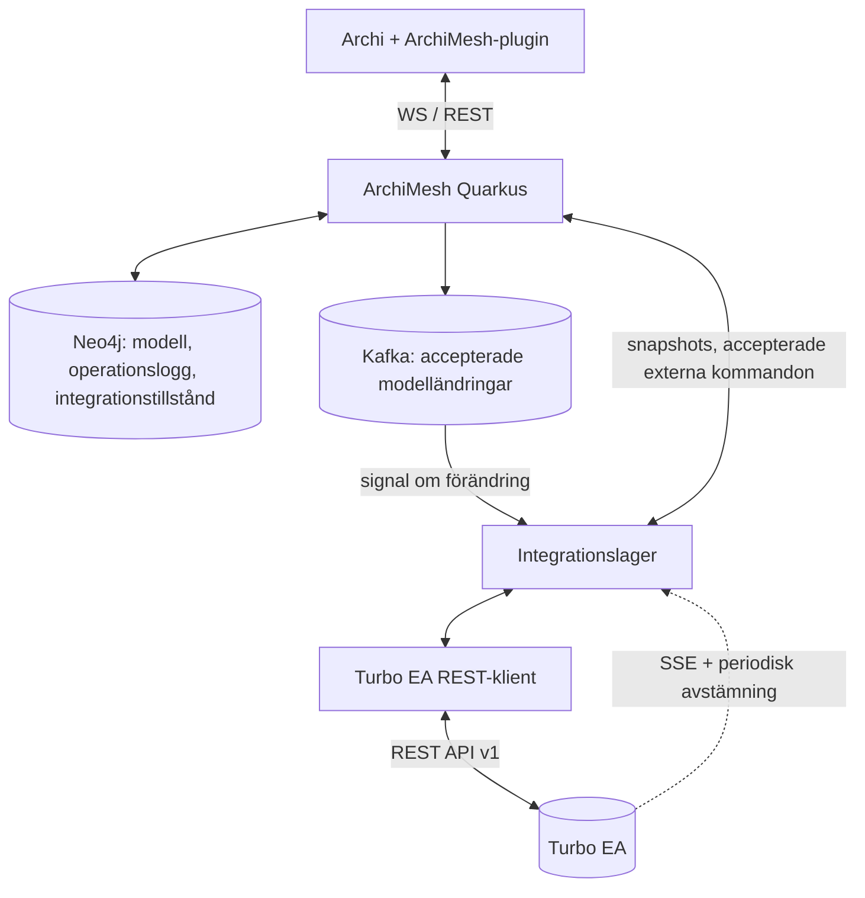

# ArchiMesh ↔ Turbo EA – implementeringsuppdrag för Codex

**Datum:** 2026-11-11  
**Repository:** https://github.com/FrodeRanders/archimesh  
**Mål:** Fungerande tvåvägsintegration mellan Archi (via ArchiMesh) och Turbo EA, utan att förlora ArchiMesh:s CRDT-, historik-, behörighets- eller återställningsegenskaper.  
**Status:** Implementationsspecifikation, inte beskrivning av redan färdig integration.

**Utökad omfattning 2026-11-12:** Projektet ansvarar nu även för en modulär
DataHub OSS ↔ Turbo EA-integration. Se [federationsuppdraget](../integrations/datahub-turboea/docs/implementation.md)
och [ADR 0002](adr/0002-three-repository-federation.md). De utökar det ursprungliga
undantaget för DataHub nedan; befintliga M0–M6-kontrakt gäller fortsatt.

> **Instruktion till Codex:** Implementera uppdraget etappvis i det aktuella ArchiMesh-repositoryt. Läs och verifiera lokal kod och Turbo EA-instansens aktuella OpenAPI innan exakta API-anrop eller klassnamn bestäms. De klassnamn och endpoints som föreslås här är ansvarsfördelningar, inte nödvändigtvis redan existerande kod. Bevara existerande kontrakt och tester. Sluta inte efter enbart design eller scaffolding.

## 1. Varför integrationen behövs

Vi vill förena tre kompletterande funktioner:

- **Turbo EA:** organisationsgemensamt arkitekturrepository med applikationer, processer, förmågor, informationsobjekt, relationer, portföljanalys och förvaltade attribut.
- **Archi:** formell ArchiMate-modellering med element, relationer och återanvändbara vyer.
- **ArchiMesh:** samtidig modellering, Quarkus-server, grafbaserat modellrepository (Neo4j), händelsedistribution (Kafka), modellhistorik och CRDT-inspirerad konflikthantering.

Målet är inte att ersätta Neo4j med Turbo EA:s PostgreSQL-databas. Turbo EA är inte ett färdigt transaktions- eller CRDT-repository för Archis EMF-modeller. **ArchiMesh fortsätter vara auktoritativt för modelloperationer och formell ArchiMate-modell. Turbo EA är auktoritativt för de företags-/myndighetsgemensamma objekt och attribut som enligt informationsförvaltningsreglerna ägs där.**

### Användarfall som ska fungera

1. En arkitekt söker i Turbo EA efter en befintlig applikation och väljer **Använd i Archi-modell**. Ett korrekt typat ArchiMate-element skapas eller återanvänds i den aktuella modellen, med en beständig identitetskoppling till Turbo EA-kortet. Elementet kan placeras i flera ArchiMate-vyer.
2. Två arkitekter modellerar samtidigt via ArchiMesh. Godkända modellobjekt och -relationer kan publiceras till Turbo EA och bidra till den samlade arkitekturbilden.
3. En centralt förvaltad applikations benämning ändras i Turbo EA. De kopplade ArchiMesh-modellerna uppdateras genom ordinarie accepterade modelloperationer och Archi-klienterna får uppdateringen via befintliga mekanismer. Historiska taggar ändras inte.
4. En behörig arkitekt kan från Archi **föreslå eller uttryckligen begära en ändring** av ett Turbo EA-ägt attribut. Ändringen genomförs bara enligt beslutad rättighets-/godkännandepolicy och synkroniseras sedan tillbaka. Vanlig modellredigering får inte tyst skriva över centralt ägda attribut.
5. Samma Turbo EA-applikation kan förekomma i flera olika ArchiMesh-modeller utan att bli flera objekt i organisationsregistret. Dess vyer och modellspecifika relationer hålls åtskilda.

### Utanför omfattningen

- Implementera ett generellt ArchiMate-modelleringsverktyg inne i Turbo EA.
- Migrera ArchiMesh:s operationslogg, kausala klockor, tombstones, vyer och notation till Turbo EA.
- Synkronisera diagramgeometri eller översätta ArchiMate-diagram till DrawIO med full fidelity.
- Bygga DataHub-integrationen nu (men förbered identitets- och auktoritetsmodellen för DataHub).
- Automatisk sammanslagning av objekt enbart efter namn.
- Automatisk hård radering av Turbo EA-kort när modellobjekt tas bort.

## 2. Läs och bevara befintlig ArchiMesh-arkitektur

Läs minst:

- `README.md`, `architecture.md`, `crdt-spec.md`, `neo4j/graph-model.md`.
- `server/README.md`, `client/README.md`, schemafiler och dokumentation för snapshots/checkpoints/pruning.
- `ArchimeshService`, `Neo4jRepositoryImpl`, `CommitDeliveryService`, `KafkaPublisherImpl`, `KafkaConsumerImpl` och befintlig auktorisationslogik.
- `EmfChangeCapture`, `OpMapper`, `ArchimeshSessionManager`, `RemoteOpApplier`, `RemoteApplyGuard` och klientens EMF-/command-stack-hantering.
- Befintligt Svelte-admin, `scripts/validate-local.sh` och release-/återställningstester.

Publik projektdokumentation beskriver (verifiera lokal version):

- Ett skrivbart `HEAD` per modell och oföränderliga, läsbara taggade revisioner.
- Servern validerar, sekvenserar och persisterar accepterade operationer atomärt i Neo4j tillsammans med den materialiserade grafen och publiceringsavsikten.
- `OpsAccepted` innebär hållbar commit; Kafka ger minst-en-gång-leverans av modellhändelser.
- Semantiska fält har angivna LWW-/Lamport-regler och tombstones. Detta är en **delvis implementerad CRDT-modell**, inte en generell transaktionell federation mellan repositories.
- Modellobjekt identifieras i dag inom en modell, exempelvis `(modelId, id)`.
- Arkitektur och återställning bygger på operationshistorik, snapshots och checkpoints.

**Icke förhandlingsbart:** Inkommande förändringar från Turbo EA som ska förändra en ArchiMesh-modell måste bli normala, servervaliderade och beständigt accepterade ArchiMesh-operationer. Skriv inte direkt till materialiserade Neo4j-noder och manipulera inte klientens EMF-modell utanför ordinarie apply-/command-stack-kontrakt.

**Icke förhandlingsbart:** Turbo EA:s otillgänglighet får aldrig blockera normal modellcommit i ArchiMesh.

## 3. Föreslagen integrationsarkitektur



Lägg huvuddelen på **Quarkus-servern**. Archi-pluginet ska endast innehålla UI och kommandon mot ArchiMesh-servern – inga Turbo EA-credentials eller egen synkroniseringsmotor.

Föreslagna ansvarskomponenter (anpassa till befintliga paket):

- `ExternalRepositoryConnector`: generiskt kontrakt mot externa arkitekturrepositories.
- `TurboEaClient`: autentisering, HTTP, pagination, DTO, rate limit och felklassificering.
- `TurboEaMetamodelMapper`: explicit ArchiMate↔Turbo EA-typ-/relationsmappning.
- `CanonicalIdentityRegistry`: kanoniska identiteter, modellförekomster och externa resurser.
- `InformationAuthorityPolicy`: auktoritativ källa per attribut och relation.
- `ExternalObjectCatalogService`: sök, förhandsgranska, länka, importera.
- `ArchitectureProjectionService`: selektiv publicering till Turbo EA.
- `ExternalChangeIngestService`: Turbo EA-ändring → tillåtna ArchiMesh-operationer.
- `ReconciliationService`: differenser, återförsök, checkpoints, konfliktregistrering.
- `IntegrationStateRepository`: separata beständiga integrationsdata.

Håll integrationslogiken separerad från CRDT-motorn, men återanvänd serverns ordinarie modelloperationstjänst vid inkommande förändringar.

## 4. Identitet: modellförekomst är inte företagsobjekt

Skilj mellan **fyra identiteter**:

1. `ModelElementKey = (archimeshInstanceId, modelId, entityKind, entityId)` – ett element/en relation i *en* ArchiMesh-modell.
2. `canonicalId` – stabil myndighetsgemensam identitet, oberoende av verktyg, t.ex. `urn:myndighet:architecture:application:4711`.
3. `TurboEaResourceKey = (targetInstanceId, cardId|relationId)` – extern resursidentifierare.
4. `SourceContributionKey` – den specifika modellens publicerade bidrag till ett gemensamt objekt eller en relation.

Relationen ska kunna vara **många modellförekomster → ett kanoniskt objekt → ett Turbo EA-kort per målmiljö**.

Föreslagen beständig modell (logiska poster, implementeras lämpligt i Neo4j med unika constraints):

```text
CanonicalObject(canonicalId, kind, state)
ModelBinding(instanceId, modelId, kind, entityId, canonicalId, bindingMode)
ExternalBinding(canonicalId, system, instanceId, resourceId, externalIdValue)
SourceContribution(canonicalId, modelId, entityId, ref, revision, fields, digest)
RelationBinding(canonicalRelationId, modelKey, turboRelationId, provenance)
FieldAuthority(typeOrCanonicalId, fieldKey, masterSystem, mode, version)
SyncCheckpoint(scope, direction, ref, revisionOrCursor, mappingVersion, digest, status)
SyncConflict(objectId, fieldOrRelation, base, modelValue, remoteValue, reason, state)
```

Isolera dessa strukturer från modellgraf, CRDT-klokor, snapshots och exportformat. Flera element i olika modeller kan referera till samma kanoniska identitet utan att dela modellrevision eller samma EMF-instans.

Turbo EA `CardCreate` och `CardUpdate` har fältet `external_id`, men **förutsätt inte unikhetsconstraint, atomär upsert eller sökbarhet på detta fält** utan att verifiera faktisk API-semantik. Bevara alltid lokalt mappingregister. Koppla manuellt till redan existerande kort; skriv inte över ett befintligt `external_id` som ägs av annat system. Matcha aldrig enbart på namn.

## 5. Två olika slags objekt – och korrekt ArchiMate-semantik

Håll isär:

- `CanonicalObject`: en förvaltad applikation, organisation, process, förmåga etc.
- `ModelElement`: ArchiMate-elementet i en viss ArchiMesh-modell.
- `ModelRelationship`: en formellt typad ArchiMate-relation i den modellen.
- `ViewObject/Connection`: grafisk presentation i en ArchiMate-vy.
- `TurboEaCard/Relation`: projektionen i Turbo EA:s arkitekturregister.

**Import från Turbo EA ska ge verkliga ArchiMate-element i modellträdet, inte enbart ritade figurer.** Samma importerade modellelement ska sedan kunna förekomma i flera vyer. Vyer och deras koordinater är ArchiMesh-/Archi-ägda och importeras/publiceras inte automatiskt till/från Turbo EA.

### Explicit, konfigurerbar typmappning

Hämta aktuella nycklar från Turbo EA:s metamodel-API. Följande är **principiella exempel**, inte verifierade nycklar eller universellt ekvivalenta begrepp:

| Turbo EA-begrepp | Möjlig ArchiMate-typ | Anmärkning |
|---|---|---|
| Application | `ApplicationComponent` | Lämpligt om kortet avser en applikationskomponent |
| Business Process | `BusinessProcess` | Rimlig direktmappning |
| Organization | `BusinessActor` | Kräver lokal definition av organisationsbegreppet |
| Business Capability | `Capability` | Kontrollera versions-/pluginstöd |
| Data Object | `BusinessObject` eller `DataObject` | Inte semantiskt likvärdiga; kräver explicit val |
| Interface | `ApplicationInterface` | Kontrollera vad det aktuella kortet avser |
| IT Component | `Node`, `SystemSoftware` eller annan | Beror på arkitekturens nivå och objektets innebörd |
| Anpassad Data Product | Ingen entydig inbyggd ArchiMate-typ | Använd dokumenterad profil/abstraktion, aldrig uppfunnen ArchiMate-klass |

Mappa också relationstyper och **riktning**, exempelvis `Serving`, `Realization`, `Flow`, `Access`, men bara när begrepp och tillåtna source/target-typer faktiskt motsvarar varandra. Skapa inte en generisk Association för allt som inte passar. Underkänn/rapportera omappbara relationer.

Krav på mapper:

- Versionerad konfiguration per Turbo EA-instans.
- Kontrollerar Turbo EA-nycklar, typ och kardinalitet mot faktiskt metamodel.
- Kontrollerar ArchiMate-relationens tillåtlighet mot Archis faktiska modellregler.
- Stöder explicit whitelist för objektstyper, relationstyper och attribut.
- Stoppar eller avviker med tydlig diagnostik vid typkonflikt.
- Klarar ändrat metamodel genom förhandsgranskad migration, inte automatiskt godtyckliga omtypningar.
- Bevarar extern typ, identitet, ursprung och mappningsversion för spårbarhet.

### Exempel på konfiguration (illustration)

```yaml
integrations:
  turboea:
    enabled: false
    targets:
      - key: development
        baseUrl: http://localhost:8920
        credentialsSecret: TURBO_EA_TOKEN
        importEnabled: true
        publicationEnabled: true
    publication:
      defaultMode: disabled    # disabled | tag
    reconciliation:
      pollIntervalSeconds: 300
    mappings:
      cardTypes:
        application: ApplicationComponent
        business_process: BusinessProcess
      relationTypes:
        # Nycklar och semantik konfigureras efter faktisk metamodelinspektion.
        # Ingen implicit fallback till Association.
```

Kod ska validera konfigurationen och ge begripliga fel om den inte stämmer med API-version eller metamodel.

## 6. Turbo EA → Archi: sök, länka, importera och återanvänd

### Avsedd användarupplevelse

Utöka ArchiMesh-pluginet med en åtgärd, exempelvis **"Hämta objekt från arkitekturrepository"**:

1. Arkitekten öppnar ett ArchiMesh-anslutet modell-`HEAD` i Archi.
2. Söker Turbo EA-objekt på namn, typ och eventuellt andra stödda filter.
3. Ser namn, typ, kortbeskrivning, identitet och om objektet redan finns i aktuell modell.
4. Väljer objekt och ser en *förhandsgranskning* av ArchiMate-typ, importerade attribut, källidentitet, regler om informationsägarskap och eventuella relaterade objekt.
5. Väljer **återanvänd befintligt länkat element**, **länka till ett kompatibelt befintligt modellelement** eller **skapa nytt ArchiMate-element**.
6. Servern kontrollerar behörighet, modellstatus, mappning och identiteter och skapar/länkar via godkända serveroperationer.
7. Samtliga ArchiMesh-klienter för modellen får det accepterade resultatet med ordinarie synkronisering.
8. Arkitekten kan dra modellelementet till valfri vy och modellera vidare med riktiga ArchiMate-relationer.

**Klienten ska inte tala direkt med Turbo EA.** Sökning och läsning går genom ArchiMesh-servern och dess auktorisationskontroller.

### Föreslagna REST-ytor i ArchiMesh (nya, inte befintliga)

```text
GET  /integrations/turboea/catalog?query=...&type=...&page=...
GET  /integrations/turboea/cards/{cardId}/preview?modelId=...
POST /models/{modelId}/external-objects/import-preview
POST /models/{modelId}/external-objects/import
POST /models/{modelId}/external-objects/link
GET  /models/{modelId}/external-objects/{elementId}/status
POST /models/{modelId}/external-objects/{elementId}/refresh
```

Anpassa URL-struktur till befintlig REST-/WebSocket-design. Använd typade DTO:er och korrelerad, idempotent importbegäran. Börja med import av ett kort och bygg därefter säker flerimport med tydligt transaktions-/partial-result-kontrakt.

### Identitets-/dubblettregler

- Samma Turbo EA-kort importeras två gånger till samma modell: normalt **samma ArchiMate-element**.
- Samma kort importeras till annan modell: nytt modell-ID/element, **samma kanoniska objekt**.
- Två olika kort med samma namn: inte samma objekt utan explicit länkning.
- Kompatibelt redan existerande element: arkitekten ska kunna koppla det utan ny kopia.
- Mappnings-/typkonflikt: stoppa utan halvfärdiga förändringar.
- Två samtidiga importförfrågningar ska konvergera mot samma binding (unikhetsconstraint, dedupliceringsnyckel och serversekvensering).

**Importerade relationer:** erbjud valbart, begränsat urval efter förhandsgranskning. Skapa först korrekta ändpunkter och sedan giltiga ArchiMate-relationer. Import betyder inte automatisk placering i en vy.

**Archi-specifikt:** undersök befintliga EMF-fabriker och model folders. Importerat element ska hamna i rätt folder och omfattas av vanliga undo/redo-, remote-apply-, modell-lock- och change-capture-kontrakt. UI-trådsregler måste följas. Import till oföränderlig tagg ska avvisas.

## 7. ArchiMesh → Turbo EA: kontrollerad publicering

### Publiceringspolicy

Per ArchiMesh-modell:

- `disabled`: ingenting publiceras.
- `head`: inte tillåtet för modellpublicering; skapa och godkänn en oföränderlig tagg.
- `tag`: publicera från explicit vald, oföränderlig och godkänd tagg (rekommenderat vid förvaltad arkitektur).

Att en operation accepterats av ArchiMesh är **inte** liktydigt med att den beslutats som fastställd myndighetsarkitektur. Gör publiceringsurval och godkännande synligt i administrationen.

### Projektionen ska byggas från materialiserat tillstånd

Använd Kafka som *signal om att en viss modell kan ha ändrats*; översätt inte varje `UpdateElement` mekaniskt till Turbo EA PATCH. En operation kan ha accepterats men förlorat ett LWW-värde på fältnivå.

Beräkna en deterministisk projektion från en konsistent snapshot vid vald referens:

```text
accepted snapshot
   -> utvalda ArchiMate-element/-relationer
   -> kanoniska objekt och källbidrag
   -> semantisk mapping + informationsägarskap
   -> önskat Turbo EA-tillstånd
   -> jämför senast verifierad baseline och faktiskt remote-tillstånd
   -> skapa / uppdatera / länka / koppla bort / rapportera konflikt
   -> verifiera och beständigt checkpointa
```

Lagra normaliserad digest per publicerat resursinnehåll; inga HTTP-skrivningar när relevant tillstånd är oförändrat. Skapa kort innan relationer. Alla anrop ska vara upprepningsbara genom återavstämning.

### Regler för publicering

- Nytt godkänt företagsobjekt utan binding kan skapa ett Turbo EA-kort, markerat enligt vald etableringspolicy (t.ex. förslag eller integrationsägt).
- Redan länkat objekt återanvänder existerande `cardId`.
- Uppdatera endast fält med **ArchiMesh som auktoritativ källa** eller explicit godkänt write-through.
- Skapa relation endast om den är semantiskt mappad, har giltiga ändpunkter och ägarskap kan fastställas.
- Flera modellbidrag till samma kanoniska objekt kräver explicit prioriterings-/sammanslagningsregel; använd inte godtyckligt senaste modell.
- Radering av ett modellelement innebär normalt endast att den modellens *referens/bidrag* tas bort. Ta inte bort objektet ur Turbo EA om andra modeller eller system refererar till det.
- Radera inte relationer eller attribut som administrerats manuellt eller av en annan integration utan explicit ägarskap.

HTTP-uppdateringar måste jämföras mot senast verifierad baseline. Läs om objektet före skrivning, använd konditionella writes *endast om de faktiskt stöds*. Utan sådant stöd kan man inte garantera atomär konfliktsäkerhet mot ändringar i Turbo EA:s webbgränssnitt: upptäck drift, verifiera efter skrivning och rapportera konflikt i stället för att påstå strikt serialiserbarhet.

## 8. Turbo EA → befintliga ArchiMesh-modeller: löpande uppdatering

Denna funktion är **inte samma sak som initial import** och behövs för verklig tvåvägsintegration.

### Upptäckt av förändringar

Turbo EA dokumenterar `GET /api/v1/events/stream` (SSE) samt läs-API för kort och relationer. Använd SSE som snabb *invalideringssignal*, **inte** som garanterat beständig logg utan att leverans, ordning och återupptagning faktiskt verifierats.

Bygg oberoende schemalagd avstämning: fråga om bundna kort/relationer, jämför normaliserade, senast verifierade fältvärden och synkronisera relevanta förändringar. Var beredd på ändrad API- eller metamodelversion.

### Applicera inkommande förändring korrekt

Vid en verifierad ändring av ett Turbo EA-ägt fält:

1. Hitta `canonicalId` och samtliga länkade modellelement i berörda modeller.
2. Kontrollera tre tillstånd: `baseline` (senast överenskommet), `remote` (aktuellt Turbo EA) och `local` (respektive ArchiMesh-HEAD).
3. Kontrollera fältägarskap, typmappning, behörigheter och att modellen är skrivbar.
4. Skapa ett typat `ExternalChangeCommand` med source, modelId, cardId, fält och korrelations-ID.
5. Låt serverns **vanliga** validerings- och operationspipeline konvertera det till en accepterad operation med korrekt kausal information och beständig commit.
6. Leverera operationen genom befintlig Kafka/WebSocket-mekanism; `RemoteOpApplier` ändrar klientens EMF-projektion under `RemoteApplyGuard`.
7. Uppdatera integrationens checkpoint först efter varaktig acceptans och verifierad konsekvens.

Upprepa för alla modellförekomster som faktiskt länkar samma kanoniska objekt. Om en viss modell saknar behörighet/policy för uppdateringen ska detta registreras som konflikt/avvikelse, inte hoppas över tyst.

### Auktorisation före CRDT/LWW

I ArchiMesh avgör kausala klockor vilken konkurrerande operation som vinner. **Informationsägarskap får däremot inte avgöras av vem som har högst Lamport-klocka.** Inför en explicit policykontroll *före* tillämpningen av vanlig fältmerge: en obehörig lokal operation för ett `TURBO_EA_MASTER`-fält ska avvisas eller behandlas som ett ändringsförslag även om dess klocka är högre.

För inkommande integration använd en identifierad, begränsad systemaktör vars servergenererade operationer får korrekt kausal information relativt senaste fältklockor. Undersök den nuvarande centraliserade serversekvenseringen och implementera utan en separat konkurrerande merge-motor. Verifiera med två samtidiga Archi-klienter och en offline-klient med köade operationer.

**Ändra aldrig historiska taggar.** Skrivbara HEAD kan uppdateras enligt policy; gamla snapshots förblir reproducerbara.

### Undvik synkroniseringsloopar

Exempel: Turbo EA byter namn → ArchiMesh accepterar nytt namn → Kafka markerar modellen ändrad → publiceringstjänsten körs. Publiceringen ska se att namn är `TURBO_EA_MASTER` och *inte skriva tillbaka* samma uppdatering som en ArchiMesh-ändring.

Använd beständiga korrelations-ID, per-fält-baselines, origin/proveniens, innehållsdigester och ägarskap. Lita inte på korta tidsbaserade spärrar; sådana fungerar inte vid fördröjningar och omstarter.

## 9. Ägarskap och kontrollerad redigering åt båda hållen

Inför ägarskap per attribut och relation. Föreslagna policyvärden:

| Policy | Betydelse | Hantering |
|---|---|---|
| `TURBO_EA_MASTER` | Gemensamt förvaltad uppgift | Turbo EA → ArchiMesh; ändring från Archi kräver explicit godkänt write-through eller förslag |
| `ARCHIMESH_MASTER` | Arkitekturmodellens förvaltade uppgift | ArchiMesh → Turbo EA vid tillåten publicering |
| `LOCAL_MODEL_ONLY` | Modellspecifik uppgift | Stannar i ArchiMesh |
| `SHARED_PROPOSAL` | Ingen part får ensidigt ändra | Ändringsförslag, godkännande eller konfliktlösning |
| `UNMAPPED` | Ingen definierad semantik | Ingen automatisk synkronisering |

Första standardpolicyn ska vara konservativ. Exempelvis kan applikationens centrala namn, livscykel och verksamhetsägare ägas av Turbo EA, medan modellspecifika relationer och dokumentation ägs av ArchiMesh och vyernas geometri är `LOCAL_MODEL_ONLY`.

### Explicit skrivning från Archi till ett Turbo EA-ägt fält

Detta krävs för att integrationen ska bli genuint tvåvägs, men det får **inte** innebära att alla fält är dubbelmaster.

1. Användaren väljer **"Föreslå/ändra central uppgift"** på ett länkat element i Archi.
2. UI visar aktuellt centralvärde, föreslaget värde, identitet, fältägare och förväntad åtgärd.
3. Servern auktoriserar användare, modell, fält och Turbo EA-skrivrätt; kontrollerar remote-värdet mot senast verifierad baseline.
4. Vid krav på godkännande skapas beständigt ändringsförslag, **ingen** omedelbar central uppdatering.
5. Vid uttryckligen tillåtet write-through uppdaterar Quarkus målresursen via Turbo EA:s API.
6. Efter verifierat fjärrresultat går förändringen genom samma **inbound external-change path** så att alla berörda ArchiMesh-modellelement uppdateras konsekvent.
7. Fel, konkurrerande ändring eller oklar fjärrstatus visas som väntande/konflikt. Visa aldrig felaktigt att båda systemen är överens.

Blockera om möjligt normal direktredigering av dessa fält i pluginets UI, men låt **serverns validering vara auktoritativ** även för offline-outbox, replay, äldre klienter och andra anropsvägar. En optimistiskt lokal ändring som nekas måste återställas/avstämmas enligt befintligt felprotokoll.

### Konflikter: trevägsjämförelse

Jämför senast verifierat `base` med `local` och `remote`. Om båda förändrats oberoende och policy inte kan avgöra, skapa `SyncConflict`; skriv inte över någon part baserat på tidsstämpel eller godtycklig LWW mellan repositories. En auktoriserad användare ska kunna välja resolution, varvid servern följer ordinarie skriv- och acceptansmekanismer och uppdaterar baseline först efter verifiering.

## 10. Beständig avstämning, idempotens och återställning

Det finns ingen gemensam transaktion mellan Neo4j och Turbo EA:s HTTP API. Utlova därför inte "exactly once" över systemgränsen. Målet är **minst-en-gång-behandling med effektivt idempotent avstämning**.

Beständig synkroniseringsstatus ska minst omfatta:

- Målmiljö, modell, ref/HEAD eller tagg, senaste observerade och senaste verifierade revision.
- Kanonisk identitet, extern resurs-ID, modellbindningar och källbidrag.
- Metamodel-/policyversion, fältdigester och senast verifierade remote-baseline.
- Väntande arbeten, dirty scopes, antal försök, senast lyckad/avvisad operation, senaste fel.
- Korrelations-ID och riktning för operationer och ändringsförslag.
- Tillstånd som `PENDING`, `SYNCED`, `DRIFT`, `CONFLICT`, `ERROR`, `PAUSED`.

Varje arbetare ska ha begränsade retries med exponentiell backoff och jitter; skilj 401/403, ogiltig typ/payload, 429 och temporära 5xx/nätfel. Operatör ska kunna pausa och återuppta.

Fall som **måste** vara säkra:

- Turbo EA skapade ett kort men svaret försvann innan lokal mapping sparades: sök/verifiera befintlig resurs eller markera tvetydig konflikt; skapa inte en dubblett.
- ArchiMesh accepterade inkommande ändring men kraschade före integrationscheckpoint: upprepad avstämning ska inte skapa dubbla modelloperationer.
- Kafka-meddelanden dupliceras, kommer i fel ordning eller försvinner efter retention: bygg önskat läge från materialiserad modell eller bevarad tagg, inte en oändlig logg.
- SSE kopplas ned: schemalagd avstämning reparerar.
- Historik har pruning men checkpoint finns: använd giltiga snapshots.
- En extern relation eller ett kort ändras manuellt: upptäck drift och respektera ägarskap.

Serialisera per modell och koordinera per kanoniskt objekt/målmiljö så att två arbetare inte skriver om samma Turbo EA-kort utifrån olika modellversioner. Äldre jobb får inte skriva över nyare önskat tillstånd.

Håll aldrig en Neo4j-modellcommit öppen under fjärr-HTTP. Synkroniseringsmetadata ska ha egna constraints och inte påverka snapshot-/export-/rebuild-logiken.

## 11. Radering och livscykel

Skilj explicit:

1. Ta bort ett element ur en ArchiMesh-modell.
2. Ta bort den modellens koppling/bidrag till ett kanoniskt objekt.
3. Ta bort en publicerad relation som integrationen äger.
4. Arkivera ett Turbo EA-kort.
5. Avveckla en verklig applikation.

Säkra standardregler:

- Radering av ett element i en modell avlägsnar i första hand modellkopplingen; andra modeller eller system kan fortfarande referera till samma kanoniska objekt.
- Ta aldrig bort ett befintligt Turbo EA-kort bara för att modellens snapshot saknas eller är tomt på grund av fel.
- Enbart relationer som bevisligen tillhör integrationen får avpubliceras automatiskt, och bara om inga andra källbidrag kvarstår.
- Arkivering i Turbo EA bör markera den externa modellen som pensionerad/deprecated, inte tyst förstöra ArchiMate-vyer.
- `404` för ett tidigare länkat kort ska ge en `ORPHANED` binding och diagnos, inte automatisk återskapning.
- Avlänkning av modellelement och hård radering av centrala objekt är skilda administrativa operationer.

## 12. Behörighet, informationssäkerhet och audit

- Alla fjärranrop går från servern; token/hemligheter lagras utanför kod, med TLS i relevanta miljöer.
- Turbo EA:s API tillämpar roll-/stakeholderbehörigheter. Använd minimalt privilegierad integrationsidentitet och verifiera hur den autentiseras i aktuell installation.
- **Viktigt:** En tjänsteidentitet med bred Turbo EA-läsrätt får inte göra skyddade arkitekturobjekt sökbara för användare som bara har ArchiMesh-modellbehörighet. Inför godkänd katalogsynlighet/delegerad användaridentitet eller en specifikt tillåten gemensam katalogdel.
- Separata åtkomstkontroller för extern katalogsökning, import/länkning, modellsynkronisering, publicering, centrala attributändringar och konfliktlösning.
- Extern systemaktör ges begränsad rätt till specifika modellelement/fält, inte generell admin-bypass.
- Verifiera inkommande text, metadata, attribut, URL:er och storlek före visning/lagring. Logga inte token eller känsliga fältvärden som standard.
- Audit ska omfatta användare/systemaktör, modell-ID, kanoniskt ID, fjärr-ID, fältnamn, åtgärd, beslut, tidpunkt och korrelations-ID.
- Integrationen kan inaktiveras utan att ArchiMesh:s grundfunktion påverkas.

## 13. Kontrollera Turbo EA:s faktiska API

Dokumentationen som granskats 2026-11-11 anger:

| Funktion | Dokumenterad API-yta |
|---|---|
| Bas-URL | `/api/v1` |
| Kort – lista/skapa | `GET/POST /api/v1/cards` |
| Kort – läsa/ändra | `GET/PATCH /api/v1/cards/{card_id}` |
| Relationer | `/api/v1/relations` och motsvarande resursendpoints |
| Metamodel – korttyper | `GET /api/v1/metamodel/types` |
| Metamodel – relationstyper | `GET /api/v1/metamodel/relation-types` |
| Ändringsnotifieringar | `GET /api/v1/events/stream` (SSE) |
| Hälsokontroll | `/api/health` |

I OpenAPI är `CardCreate` definierad med obligatoriska `type` och `name`, och valfria bland annat `external_id`, `attributes` och `description`. `RelationCreate` har obligatoriska `type`, `source_id`, `target_id` och valfria `attributes`, `description`.

**Codex måste verifiera** aktuella request-/response-scheman, autentiseringsflöde, pagination, unikhetsregler, tillåtna PATCH-semantiker, eventinnehåll och felstatus mot *den faktiska Turbo EA-version som används*. Förutsätt inte idempotency keys, ETags/`If-Match`, SSE-resume eller särskilda bulk-upsert-garantier om de inte faktiskt finns. Generera gärna en klient från OpenAPI om det passar projektets Quarkus-/Java-stil, men isolera genererad kod bakom ett tydligt applikationskontrakt.

Källor:

- https://docs.turbo-ea.org/admin/api/
- https://docs.turbo-ea.org/api/openapi.json
- https://docs.turbo-ea.org/admin/metamodel/

## 14. UI i Archi och ArchiMesh-administration

### Archi-plugin

Skapa en samlad meny/funktion **Enterprise Repository** med:

- Sökning i Turbo EA:s inventering, filter och paginering.
- Förhandsgranskning av objekt, ArchiMate-typ, ägarskap och aktuella kopplingar.
- Skapa/länka/återanvänd modellobjekt, med klar hantering av dubbletter.
- Valfri import av relationer med preview.
- Öppna ursprungligt Turbo EA-kort.
- Visa källsystem, central identitet, synkstatus och master för valda attribut.
- Manuell refresh / begär avstämning.
- Begär/föreslå en centralt förvaltad ändring, med tydlig bekräftelse eller godkännandekedja.
- Visning av fel, ej godkända ändringar och konflikter utan att användaren förlorar lokal arbetskontext.

Använd befintligt Eclipse-/EMF-kommandomönster. Importerade element ska ligga i korrekt modellmapp och kunna användas i flera vyer. Diagramplacering är en separat Archi-funktion och ska inte vara beroende av att Turbo EA kan rita ArchiMate.

### Server och Svelte-admin

Lägg till:

- Konfiguration av målmiljöer och integrationsfunktionernas av/på-läge.
- Metamodelmappning, validering och versionsstatus.
- Policy för fältägarskap och relationer.
- Modellpublicering: `disabled`, `tag`. Centrala ändringsförslag har separat godkännande.
- Status per modell, kanoniskt objekt, binding, riktning och synkroniseringsjobb.
- Dry-run av import/publicering/avstämning.
- Manuell avstämning, retry, paus/återuppta och konfliktlösning.
- Revision/audit och mätvärden för synklag, fel, retries, antal uppdateringar och oförenliga mappningar.

Se till att nya API-ytor använder ArchiMesh:s normala autentisering och auktorisation. Adminverktyg ska inte ge skrivåtkomst till modellhistorik utanför ordinarie operationsväg.

## 15. Framtida DataHub-federation – arkitekturkrav, inte implementation

Samma organisation etablerar **DataHub** som datakatalog för datamängder, datasets, Kafka-topics, dataprodukter, teknisk lineage och metadata. Denna Codex-leverans ska **inte** implementera DataHub, men dess gränssnitt ska inte låsa identitetsmodellen till två system.

Framtida målbild:

- En dataprodukt kan ha sin auktoritativa identitet som DataHub-URN.
- Turbo EA kan innehålla ett representationskort för dataprodukten och relationer som `PRODUCES`, `TRANSFORMS`, `CONSUMES` till applikationer.
- Archi/ArchiMesh kan modellera godkända arkitekturella relationer med dessa gemensamma objekt.
- Ingen av de två senare får automatiskt skriva över DataHub-ägda produktmetadata.

Därför ska `sourceSystem`, `targetSystem`, `instanceId`, `canonicalId`, `FieldAuthority` och `ExternalRepositoryConnector` vara generella begrepp. Anta inte att alla kanoniska objekt uppstår i Turbo EA. Implementera enbart en kort ADR om möjlig framtida `DataHubConnector` och hur den återanvänder dessa abstraktioner.

## 16. Tester och acceptanskriterier

Skapa en mockad Turbo EA HTTP-server i ordinarie tester och helst en separat, frivillig end-to-end-profil mot en disponibel Turbo EA-instans. Bygg testfall minst för:

### Import, identitet och Archi-modell

1. Sök Turbo EA-kort och importera `Application` som korrekt `ApplicationComponent` enligt explicit mappning.
2. Samma kort importeras två gånger i samma modell: ingen dubblett.
3. Samma kort importeras till två modeller: två modellelement men samma kanoniska identitet/kort.
4. Länka kompatibelt redan existerande modellelement utan ny kopia.
5. Felaktig typ/relation: tydligt avslag utan partiella förändringar.
6. Två samtidiga importbegäranden: identitetsregister förblir entydigt.
7. Importerat element återfinns i modellträdet och kan användas i två vyer; samma EMF-semantiska element refereras från båda.
8. Modellens checkout, snapshot, historik och återställning fungerar efter import.

### Uppdateringar i båda riktningarna

9. Nytt ArchiMesh-objekt publiceras till ett nytt Turbo EA-kort med hållbar ID-koppling.
10. Ompublicering/återavstämning skapar inte dubbletter och gör inga onödiga uppdateringar.
11. Befintlig Turbo EA-app byter namn: alla länkade skrivbara HEAD får en accepterad operation och korrekt namn.
12. Historisk tagg är oförändrad.
13. Lokalt försök att ändra ett `TURBO_EA_MASTER`-fält via vanlig EMF-redigering avvisas enligt serverpolicy, även från offlinekö.
14. Tillåten explicit write-through från Archi ändrar Turbo EA och resulterar i konsekvent uppdatering av alla länkade modeller.
15. Förslagsstyrt fält ger ändringsförslag; central källa ändras först efter godkännande.
16. Samtidiga ändringar av samma fält ger dokumenterad och lösbar konflikt där policy inte ger ensam master.
17. Turbo EA-originated ändring som publiceras vidare via ArchiMesh skapar inte återkopplingsloop.
18. SSE-duplicering, Kafka-dubbletter och no-op ger inte dubbla accepterade modelloperationer.
19. Relationer publiceras/importeras bara med uttrycklig giltig semantik och riktning.

### Förvaltning, återställning, säkerhet

20. Radering av modellreferens förstör inte ett centralt kort som andra modeller använder.
21. Extern arkivering markerar/larmar men raderar inte Archi-vyer.
22. Turbo EA-skapande lyckas men HTTP-svar/lokal mapping saknas: säker återhämtning eller synlig tvetydig konflikt, ingen okontrollerad dubblett.
23. ArchiMesh-commit lyckas men integrationens checkpoint försvinner: säker reprocessing.
24. Kafka-/SSE-avbrott, nätfel och historikpruning repareras via full avstämning.
25. 401, 403, 429, 5xx, timeout och felaktig payload hanteras med rätt retry-/diagnosklass.
26. Modell-ACL skyddar import, länkning och modelloperationer.
27. Serverns serviceidentitet kan inte exponera skyddade Turbo EA-kort för obehöriga användare.
28. Integrationsaktör kan inte kringgå attributägarpolicy genom större Lamport-klocka.
29. Befintliga ArchiMesh-tester för samtidighet, lås, checkpoint, snapshots och recovery förblir gröna.

### Definition of done – demonstrerbart slutscenario

En arkitekt importerar en befintlig applikation från Turbo EA till Archi, använder den i flera vyer och arbetar samtidigt med en kollega via ArchiMesh. En annan modell refererar till samma centrala applikation. En ändring av namnet i Turbo EA uppdaterar alla HEAD-modeller, medan gamla taggar är oförändrade. En tillåten modellrelation publiceras till Turbo EA. En behörig arkitekt begär en central attributändring från Archi, vilken utförs enligt policy och synkas tillbaka. Om server eller nät går ned kan avstämning återuppta utan förlorade ändringar, dubbletter eller oändliga slingor.

## 17. Arbetsordning för Codex

Genomför **separata, testbara milstolpar** och gör en commit efter varje stabil etapp.

| Milstolpe | Omfattning | Färdig när |
|---|---|---|
| **M0 – Analys/ADR** | Läs lokal kod, verifiera aktuell Turbo EA API-version, designa identitet/ägarskap och notera risker | ADR, kodkartläggning och regressionsbaslinje finns |
| **M1 – Integrationens grund** | Abstraktioner, Neo4j-metadata, constraints, mappning, klient och mocktester | Metadata och klient fungerar utan ändring av CRDT-motorn |
| **M2 – Turbo EA → Archi: import** | Katalogsökning, preview, länka/importera, plugin-UI, modelloperationer | Arkitekten kan återanvända centralt objekt i ArchiMate-vy |
| **M3 – ArchiMesh → Turbo EA: publicering** | Snapshotprojektion, policies, diff, kort/relationsskrivning, mapping/checkpoint | Godkänd modell publiceras upprepningsbart utan dubblering |
| **M4 – Externa ändringar tillbaka** | SSE/polling, baseline, external-change-acceptans, klientuppdatering, offlinepolicy | Extern uppdatering når länkade HEAD-modeller, ej taggar |
| **M5 – Kontrollerad tvåvägsredigering** | Write-through/proposal UI, auktorisation, trevägskonflikter, loopskydd | Behörig ändring från Archi blir korrekt central ändring och återkommer konsekvent |
| **M6 – Drift och leverans** | Admin-UI, metrics, full avstämning, migrations-/driftinstruktion och återställningstest | Kan driftsättas, pausas, felsökas och återhämta sig |

Om en milstolpe kräver modifiering av ArchiMesh:s gemensamma operations-/CRDT-kärna ska förändringen vara minimal, tydligt motiverad, testad och dokumenterad. Inför inte ett andra konkurrerande event-/commitramverk.

## 18. Validering och releasekrav

Använd existerande scripts. Kör beroende byggsteg **sekventiellt** när de delar build-kataloger:

```bash
./scripts/validate-local.sh fast
./scripts/validate-local.sh gate
./scripts/validate-local.sh server-isolated
```

Kör även relevanta `infra`, `ws` och `recovery`-tester när ändringar påverkar modelloperationer, leverans, klient eller återställning. Använd isolerad testmiljö – rensa aldrig utvecklarens bestående databaser, volymer eller Kafka-topics för att få testresultat.

Codex ska leverera:

1. Källkod i avgränsade moduler/paket, klient-UI och servergränssnitt.
2. Beständiga identiteter, bindings, ägarskap, synkcheckpoint och konflikter med migrations-/constraintskript.
3. Konfigurationsexempel och säker hantering av credentials.
4. Typ-/relationsmappning och en användbar uppsättning initiala regler.
5. Automatiska tester (unit, mock-API, klient, integration och återställning).
6. ADR om identiteter, kausalitet, behörighet, informationsägarskap och återställning.
7. Administrations-/driftdokumentation och felsökningsinstruktioner.
8. Separat kort framtidsnot om DataHub utan att implementera den integrationen.
9. Sammanfattning av utförda commits, tester, kvarstående begränsningar och rekommenderade nästa steg.

**Prioritera fungerande end-to-end-flöden, korrekt identitet och säker återställning framför mängden funktioner.**

## 19. Referenser

### ArchiMesh

- Repository: https://github.com/FrodeRanders/archimesh
- Arkitektur: https://github.com/FrodeRanders/archimesh/blob/main/architecture.md
- CRDT: https://github.com/FrodeRanders/archimesh/blob/main/crdt-spec.md
- Neo4j-datamodell: https://github.com/FrodeRanders/archimesh/blob/main/neo4j/graph-model.md
- Server: https://github.com/FrodeRanders/archimesh/blob/main/server/README.md
- Klient: https://github.com/FrodeRanders/archimesh/blob/main/client/README.md

### Turbo EA

- API: https://docs.turbo-ea.org/admin/api/
- Aktuell OpenAPI: https://docs.turbo-ea.org/api/openapi.json
- Metamodel: https://docs.turbo-ea.org/admin/metamodel/

### Archi och ArchiMate

- Archi: https://www.archimatetool.com/
- ArchiMate: https://www.opengroup.org/archimate-forum/archimate-overview

**Versionsanmärkning:** Texten bygger på publik ArchiMesh-dokumentation och Turbo EA:s API/OpenAPI som var åtkomlig 2026-11-11. Kod och produktversion kan ha ändrats; Codex ska verifiera lokala källor och målmiljö, och får inte behandla denna text som en exakt aktuell API-signatur.
