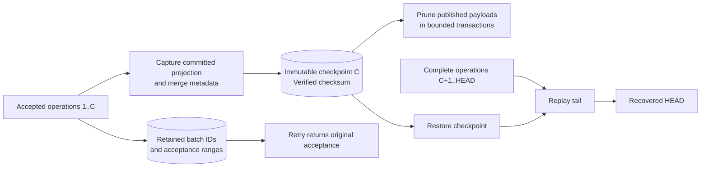

# Checkpoints and operation payload pruning

Archimesh can replace an old operation prefix with a durable recovery checkpoint. Maintenance is available as model-admin operations or through an opt-in server scheduler. It reduces operation payload storage while preserving current model state, merge behavior, retry deduplication, and tagged snapshots.

## Recovery data

A checkpoint records a committed revision `C` and the raw model projection: elements, relationships, folders, views, diagram objects, connections, graph edges, property values, field and membership clocks, property clocks, and tombstones. Orphan merge metadata is included. Catalog metadata, ACLs, tags, and acceptance receipts are stored separately.

Checkpoints use `archimesh-checkpoint-v1` and a SHA-256 checksum over their canonical JSON metadata and state. The server validates the checksum, model scope, identities, property types, labels, and edge endpoints before use. A checkpoint at a given model/revision is immutable; repeating creation at the same head returns the existing checkpoint. Unsupported graph state or native property types cause creation to fail before any payload can be pruned. The checksum detects accidental changes; it is not an authenticity signature.



## Operator workflow

Use the Models page in `/admin-ui/`, or these endpoints with the authentication headers appropriate to your deployment. Checkpoint creation and pruning require model-admin access; global admins also have access.

```bash
# 1. Capture the current committed HEAD.
curl -s -X POST http://localhost:8081/admin/models/demo/checkpoints

# 2. Inspect the latest checkpoint summary (404 when none exists).
curl -s http://localhost:8081/admin/models/demo/checkpoints/latest

# 3. Preview eligibility without changing model data.
curl -s -X POST 'http://localhost:8081/admin/models/demo/compact?retainRevisions=1000&dryRun=true'

# 4. Apply the same retention policy; repeat while eligible batches remain.
curl -s -X POST 'http://localhost:8081/admin/models/demo/compact?retainRevisions=1000'

# 5. Export the recoverable model package.
curl -s http://localhost:8081/admin/models/demo/export -o demo.json
```

Keep a full-history export or database backup **before pruning** if you need the individual old operations for audit or analysis. A later checkpoint export preserves recovery state and acceptance receipts, rather than those removed payloads. Checkpoints are stored in the same Neo4j database as the model and do not replace off-system backups.

## Eligibility and bounds

The payload cutoff is the smaller of the latest checkpoint revision and `latestCommitRevision - retainRevisions`. Only whole batches ending at or below that cutoff qualify. Head/commit disagreement disables pruning. The first unpublished batch fences pruning of it and every later batch, even if later publication flags are set. Legacy commits with no publication flag are treated as unpublished.

Without a checkpoint, compaction retains every payload. Eligible runs delete `Op` nodes and remove `Commit.batchJson`, marking the commit `payloadPruned=true`. The compact `Commit` record, batch ID, revision range, and timeline links remain. All clocks and tombstones remain, including orphan property clocks, so stale offline operations still meet the same merge barriers.

Each applied call handles at most `app.compaction.max-batches-per-run` batches (default `100`, environment variable `ARCHIMESH_COMPACTION_MAX_BATCHES`). This bounds the batch count per deletion transaction; a single large batch can still be expensive. Existing revision retention defaults to `app.compaction.retain-revisions`; `retainRevisions=0` allows pruning everything covered and published.

Responses include `checkpointRevision`, `watermarkRevision`, `eligibleBatchCount` before the run, `prunedBatchCount`, `deletedOpCount`, `prunedThroughRevision`, `dryRun`, and an explanatory `note`. Preview returns zero deletion counts. Repeat applied calls until `eligibleBatchCount` is zero. Commit, property-clock, and tombstone deletion counts remain zero. Legacy metadata eligibility counters are diagnostics, not permission to collect merge metadata.

## Rebuild, reconnect, and transfer

Rebuild verifies the latest checkpoint and requires an exact contiguous operation tail from `C+1` through the latest committed revision. It restores the raw checkpoint, replays that tail, and replaces the projection in one transaction. Invalid recovery data is rejected before replacement; transaction failures roll back the replacement. Without a checkpoint, a complete log starting at revision 1 is still required.

Existing reconnect logic detects a missing delta prefix and sends a current snapshot. Clients keep the same WebSocket protocol. A retry of a pruned batch still returns its original acceptance range from the retained receipt.

Exports without checkpoints use the existing `archi-model-export-v1` package. Checkpointed exports use `archi-model-export-v2`, containing the checkpoint, prefix acceptance receipts, a complete tail, current snapshot, catalog/ACL data, and tag snapshots. V2 restore validates coverage and restores the model in one transaction; a failed overwrite leaves the destination unchanged. Changing `model.modelId` imports into another model namespace: the server verifies the source checkpoint and rebinds it with a new checksum. See [export format](../server/EXPORT_FORMAT.md).

## Optional scheduled maintenance

The scheduler is **disabled by default**. Enable it through server configuration after deciding how to archive historical operations. Enabling applies the policy to all registered models; it does not create an external archive. The first scheduled pass starts after the configured interval.

| Property | Environment variable | Default | Meaning |
| --- | --- | --- | --- |
| `app.checkpoints.maintenance.enabled` | `ARCHIMESH_CHECKPOINT_MAINTENANCE_ENABLED` | `false` | Enable creation, payload pruning, and old-checkpoint cleanup. |
| `app.checkpoints.maintenance.interval-seconds` | `ARCHIMESH_CHECKPOINT_INTERVAL_SECONDS` | `300` | Delay between completed passes. |
| `app.checkpoints.maintenance.min-revisions` | `ARCHIMESH_CHECKPOINT_MIN_REVISIONS` | `1000` | Minimum new revisions since the latest checkpoint, or since revision zero for the first one. |
| `app.checkpoints.maintenance.retain-checkpoints` | `ARCHIMESH_CHECKPOINT_RETAIN_COUNT` | `2` | Number of newest checkpoints to keep per model; must be at least one. |
| `app.checkpoints.maintenance.models-per-run` | `ARCHIMESH_CHECKPOINT_MODELS_PER_RUN` | `10` | Maximum models visited per pass, rotating through the sorted catalog. |
| `app.compaction.retain-revisions` | `ARCHIMESH_COMPACTION_RETAIN_REVISIONS` | `1000` | Recent revision window whose payloads remain. |
| `app.compaction.max-batches-per-run` | `ARCHIMESH_COMPACTION_MAX_BATCHES` | `100` | Maximum payload batches pruned per visited model. |

Enabled scheduler policy values must be positive; revision retention may be zero. A model below the checkpoint threshold is still eligible for pruning and cleanup if it already has a checkpoint. Repeated visits finish a backlog without requiring another checkpoint or a new edit. No checkpoint is created for an empty model automatically.

Each model visit acquires the service's timeline serialization, checks the writer lease, optionally captures a new checkpoint, prunes one bounded payload set, then cleans up older checkpoints. Before checkpoint cleanup, the repository verifies the newest checkpoint, contiguous acceptance receipts, and complete tail. At most 100 old checkpoints are removed per model visit; the newest configured count is always kept. Tags, acceptance receipts, and CRDT metadata are unaffected. Manual checkpoints participate in the same retention policy when scheduling is enabled.

These phases commit separately. If a later phase fails, completed safe work remains committed and the next visit resumes from durable state. A failure in one model is logged and does not starve other models. A lost writer lease stops further model processing; maintenance mutations also verify the lease in their database transactions. The worker runs on one background thread and stops on server shutdown. Significant results appear in server logs and model activity; no maintenance cursor is needed for recovery. Rotation restarts from the first model after server restart.

## First-version limits

Creation, pruning, and rebuild run under the authoritative service's existing serialization. Capturing a large projection or restoring it can pause edits and uses memory proportional to the model. Deletion is bounded by batch count; checkpoint capture/restore is not streamed. The scheduler loads the model catalog each pass. Acceptance receipts accumulate indefinitely; older checkpoints accumulate when scheduled maintenance is disabled. CRDT metadata garbage collection and a multi-writer protocol remain unimplemented. Measure these costs before enabling an automated policy.

Models whose historical operation data was removed by an older implementation need a complete backup/export restore before creating their first checkpoint; the server rejects incomplete recovery coverage. Unclassified legacy publication state remains protected and requires a deliberate migration rather than a pruning bypass.
