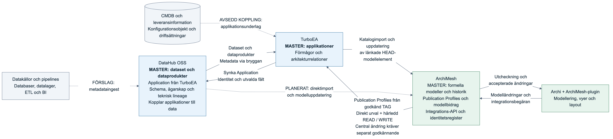
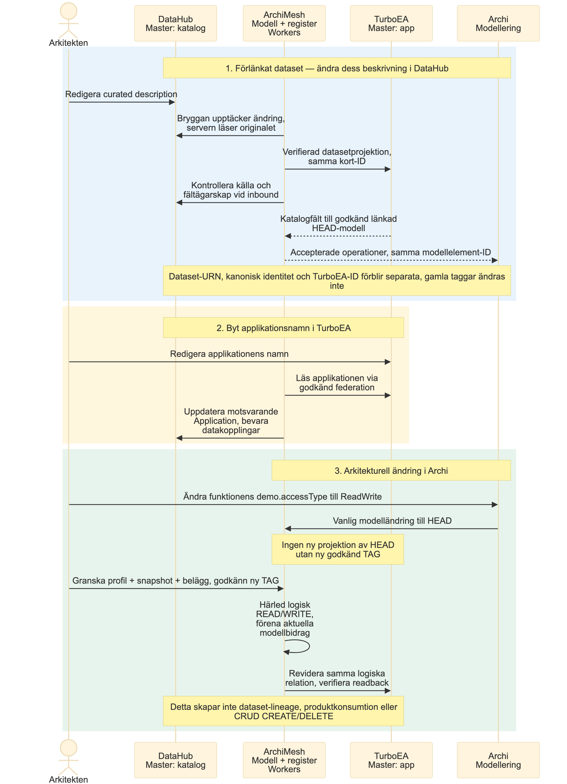

# Systemöversikt och metadataflöden

Diagrammet finns som redigerbar [Mermaid-fil](diagrams/ecosystem-dataflows.mmd),
[PNG](diagrams/ecosystem-dataflows.png) och [SVG](diagrams/ecosystem-dataflows.svg).
Det beskriver den implementerade samverkan inklusive Publication Profiles,
avläst 2026-11-16. Den startbara Northstar-demon använder syntetiska data. Det är ingen inventering av en produktionsmiljö.

Heldragna pilar visar implementerade flöden som kräver rätt konfiguration och
godkännanden. Streckade pilar är märkta **PLANERAT** när flödet ingår i projektets
fortsatta leverans, eller **FÖRSLAG** när kopplingen är ett antagande för denna
systembild. **AVSEDD KOPPLING** visar den angivna inriktningen från CMDB och
leveransinformation till TurboEA; implementationen är inte verifierad här.



## Ansvar och informationsägarskap

| Del | Ansvar och information |
| --- | --- |
| DataHub OSS | Master för dataset och dataprodukter samt katalog för schema och teknisk lineage. Kan även innehålla Application som representation av en TurboEA-applikation och koppla denna till data. DataHubs egna applikationsspecifika fält kan förvaltas separat. |
| TurboEA | Master för applikationernas identitet och utvalda centrala fält, med underlag från CMDB och leveransinformation. Centralt arkitekturrepository för förmågor och arkitekturrelationer. Kan också innehålla representationer av DataHub-dataset. |
| ArchiMesh | Gemensamt modelltillstånd, historik, samarbete och serverstyrda integrationer. Äger idag det gemensamma identitetsregistret och kontrollen av integrationsskrivningar. |
| Archi med plugin | Arkitektens modelleringsverktyg. Redigerar lokala modeller och diagram; skickar ändringar och integrationsbegäran till ArchiMesh och tar emot accepterat modelltillstånd. |
| Federationsbryggan | Upptäcker dataset/dataprodukter och initierar godkända projektioner till TurboEA. Synkar utvalda TurboEA-applikationer till DataHub. Separat worker och serverdel i ArchiMesh; behöver ingen Archi-modell eller aktiv Archi-klient. |
| CM-databas / CMDB och leveransinformation | Underlag för applikationer i TurboEA: konfigurationsobjekt, driftsättningar och realiserade tekniska beroenden. Den konkreta kopplingen och ägarskap per fält är inte verifierade i detta repository. |
| Dataplattformar och pipelines | Föreslagna ursprung för teknisk metadata till DataHub. Exakta ingest-kopplingar och deras driftsättning måste bestämmas för miljön. |

Pilarna gäller **metadata, modelländringar och styrbegäran**. Diagrammet innebär
inte att verksamhetsdata eller databasernas innehåll kopieras mellan systemen.

## Hur flödena fungerar

1. **Dataset från DataHub till TurboEA.** En separat worker upptäcker dataset via
   DataHubs API och anropar ArchiMesh-serverns federations-API. Serverdelen läser
   originalkällan, kontrollerar godkännandet och skapar eller uppdaterar en
   datasetrepresentation i TurboEA. Den genomförda delen omfattar identitet, namn
   och beskrivning för både dataset och dataprodukter.
2. **TurboEA till ArchiMesh och Archi.** Arkitekten väljer ett objekt ur den
   godkända katalogen. Servern importerar eller länkar det som ett modellelement.
   Senare uppdateringar går till länkade, godkända HEAD-modeller. Archi får
   ändringarna genom sin vanliga anslutning till ArchiMesh. Placering i en vy är
   ett separat modelleringssteg.
3. **ArchiMesh till TurboEA.** Publication Profiles väljer inom modellens
   uttryckligen godkända urval. ApplicationComponent → Assignment →
   ApplicationFunction → Access → logiskt DataObject kan ge en konsoliderad
   READ/WRITE-relation, med källmodell, tagg, revision och funktions-/relations-ID
   som belägg. Publicering sker från en uttryckligen godkänd, oföränderlig tagg.
   Befintliga identiteter återanvänds; varje modell behåller sitt eget bidrag.
   Borttaget bidrag raderar inte andra modellers eller manuellt ägda relationer. Ändringar av centralt
   ägda fält har ett separat flöde för förslag eller tillåten direkt begäran;
   efter verifierad skrivning återförs ändringen till länkade HEAD-modeller.
4. **Application till DataHub.** Den godkända synken läser TurboEA och skapar,
   uppdaterar eller uttryckligen kopplar ett native Application i DataHub.
   Gemensam identitet, ägarskap och manuella avvikelser kontrolleras av servern.
   Direkt modellimport från DataHub är fortfarande planerad.
5. **CMDB och metadataingest.** CMDB och leveransinformation utgör enligt den
   avsedda systembilden underlag för applikationsinformationen i TurboEA. Exakta
   fältregler och den faktiska integrationen behöver stämmas av mot miljön.
   Metadataingest från dataplattformar till DataHub visas som ett förslag.

## Samma applikationsbegrepp i TurboEA och DataHub

Den avsedda huvudriktningen är **CMDB/leveransinformation → TurboEA → DataHub
Application**. TurboEA är master för applikationens identitet och överenskomna
fält, exempelvis namn, beskrivning och livscykel. DataHub använder sin
Application-representation för att knyta dataset och dataprodukter till den
applikationen. Att Application finns i båda systemen innebär därmed inte att
båda är master för samma fält.

Den implementerade synken använder samma federationsregister som datasetflödet:

- Den binder TurboEA-applikationens exakta ID och DataHub Applications fullständiga URN
  till samma kanoniska identitet när begreppen är likvärdiga. Namnbyte ska inte
  skapa en ny applikation. Befintliga objekt behöver en granskad koppling.
- Den överför endast överenskomna applikationsfält från TurboEA till DataHub och
  bevarar DataHub-specifika fält, tekniska dataägare och datakopplingar.
- Bestäm separat var relationen **applikation–dataset/dataprodukt** förvaltas.
  Applikationssynk ger inte automatiskt TurboEA rätt att skriva dessa relationer.
- Om ett lokalt Application i DataHub betyder en bredare verksamhetsgruppering
  än en TurboEA-applikation, behåll separata identiteter och skapa en uttrycklig
  relation. Den lokala begreppsmappningen behöver därför granskas.

Se [implementation och konfiguration](../integrations/datahub-turboea/docs/application-bridge.md).
Livscykel kan överföras som en särskilt konfigurerad custom property; datakopplingar
och andra Application-fält bevaras. En dubbelriktad transport kan senare behövas för vissa fält eller relationer,
men varje fält ska fortfarande ha en bestämd master. Ändringsförslag från DataHub
till TurboEA blir i så fall ett separat godkänt flöde.

Ett DataHub-dataset behåller DataHub som källa för sina förvaltade fält även när
det läses via TurboEA. Vid import av en verifierad datasetrepresentation läser
servern därför också originalet i DataHub. Det gemensamma identitetsregistret
kopplar DataHub-URN, TurboEA-ID och modellelement till samma kanoniska identitet;
namnlikhet räcker inte. Samma objekt kan förekomma i flera modeller med olika
lokala element-ID:n.

Pilen DataHub → TurboEA visar ett logiskt integrationsflöde via datasetbryggan.
Workern styr urval och körning; API-anrop till TurboEA och den auktoritativa
registerhanteringen ligger idag i ArchiMesh-servern. Det finns ett gemensamt
identitetsregister för bryggan och modellimporten. Webbadministrationen används
för profilval, förhandsvisning, godkännande och uppföljning och är utelämnad ur översiktsbilden.

ArchiMesh använder **Neo4j** för modeller, historik och integrationsmetadata samt
**Kafka** för distribution av accepterade modellhändelser. Dessa interna
komponenter är utelämnade ur översiktsbilden; se den befintliga
[systemkontexten](manual/diagrams/system-context.mmd). DataHubs egna interna
lagrings- och meddelandetjänster är separata.

## Visa flödena i en demo

Starta hela den syntetiska miljön med `./scripts/demo.sh up --open` från
projektroten. Befintlig förberedd miljö återupptas med `./scripts/demo.sh start
--open`. [Presentatörsguiden](../examples/order-management/DEMO.md) beskriver en
15–20 minuters demo och vilka ändringar som görs i respektive master.



Sekvensen finns som [Mermaid](diagrams/demo-walkthrough.mmd) och
[SVG](diagrams/demo-walkthrough.svg). En bra ordning är:

1. Ändra ett datasets **beskrivning i DataHub**. Se samma metadata i TurboEA och
   i det redan länkade modellelementet i ArchiMesh/Archi. Identiteterna består.
2. Ändra ett **applikationsnamn i TurboEA**. Se dess DataHub Application uppdateras;
   Application-kopplingar till dataset bevaras. DataHub är fortsatt master för
   datasetet och egna Application-fält.
3. Ändra **funktionens Access-egenskap i Archi**: `demo.accessType`, exempelvis
   `Read` eller `ReadWrite`. Se ändringen i ArchiMesh HEAD. TurboEA behåller den
   tidigare godkända projektionen tills en ny tagg har granskats och godkänts.
4. Kör `./scripts/demo.sh publish` för demon, eller gör granskningen manuellt i
   administratörens Publication-sida. Se READ/WRITE och belägg för den nya taggen
   i den särskilda logiska relationen i TurboEA. Diagramlayout och interna
   funktioner blir inte nya katalogkort; CREATE/DELETE och lineage härleds inte.
5. Kör publiceringen igen och visa samma kort-/relations-ID. En källändring i
   HEAD skriver inte om en gammal tagg. Stopp/start behåller miljön och identiteterna.

`./scripts/demo.sh walkthrough` gör en automatisk, återställande masterändring
på det förlänkade datasetet och verifierar flödet, Application-synken,
produktupptäckt och upprepad profilpublicering. Den fungerar utan en öppen
Archi-klient. Archi med installerad plugin visar samma accepterade ändringar.
CMDB och verkliga verksamhetssystem startas inte: deras avsedda roll visas i
översikten, medan demon använder fixturedata.

## Exportera till PNG eller SVG

Utan lokal installation: öppna [Mermaid Live Editor](https://mermaid.live), klistra
in hela innehållet från `.mmd`-filen i **Code** och välj **Actions → export PNG**
eller **export SVG**. Se [Mermaids exportguide](https://mermaid.js.org/intro/getting-started.html#saving-a-diagram).

För lokal export används [Mermaid CLI](https://github.com/mermaid-js/mermaid-cli).
Installera verktyget om det saknas; det kräver Node.js/npm och en fungerande
Chromium/Puppeteer-runtime. Kör följande från projektroten:

```bash
# Bara om mmdc saknas; exporterna nedan verifierades med version 11.12.0.
npm install -g @mermaid-js/mermaid-cli@11.12.0

# PNG med vit bakgrund och dubbel pixeltäthet.
mmdc -i docs/diagrams/ecosystem-dataflows.mmd -o docs/diagrams/ecosystem-dataflows.png -b white -w 2400 -s 2

# SVG behåller skärpan vid förstoring.
mmdc -i docs/diagrams/ecosystem-dataflows.mmd -o docs/diagrams/ecosystem-dataflows.svg -b white -w 2400

# Samma export för demons sekvensdiagram.
mmdc -i docs/diagrams/demo-walkthrough.mmd -o docs/diagrams/demo-walkthrough.png -b white -w 2200 -s 2
mmdc -i docs/diagrams/demo-walkthrough.mmd -o docs/diagrams/demo-walkthrough.svg -b white -w 2400
```

Spara `.mmd` som original och regenerera bilderna efter ändringar. PNG passar
för direkt inklistring i dokument och presentationer; SVG kan förstoras utan
pixelförlust.

## Projektunderlag

- [Genomförd datasetbrygga och kvarvarande leverans](../integrations/datahub-turboea/docs/dataset-bridge.md).
- [Informationsägarskap och flödesriktningar](../integrations/datahub-turboea/docs/authority-directions.md).
- [Identitet och federation, ADR 0002](adr/0002-three-repository-federation.md).
- [TurboEA-katalog och import](turboea/m2-import.md),
  [taggbaserad publicering](turboea/m3-publication.md),
  [inkommande uppdateringar](turboea/m4-inbound.md) och
  [centrala ändringsbegäranden](turboea/m5-central-edits.md).
- [Publication Profiles, rättigheter och återställning](publication-profiles.md).
- [ArchiMesh internarkitektur](../architecture.md).
