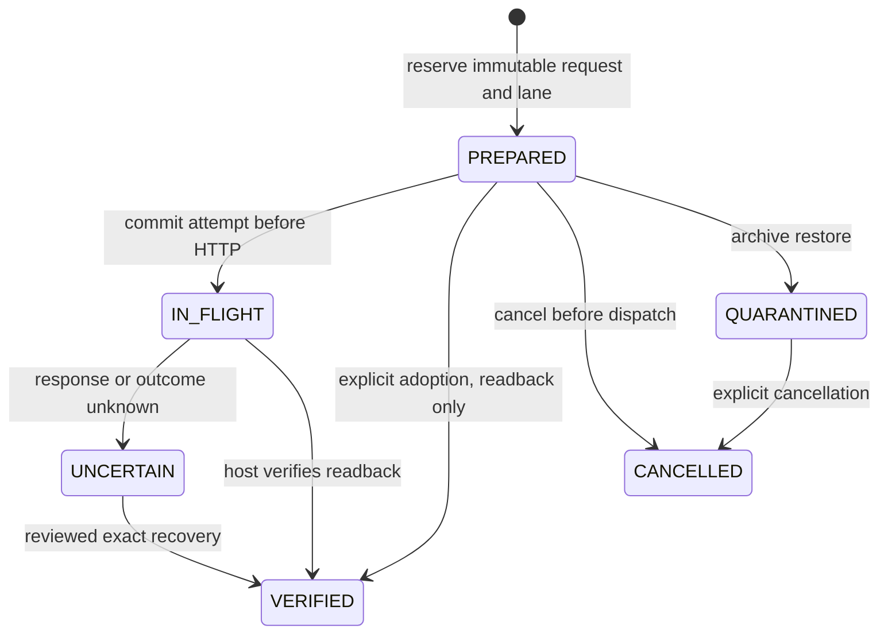

# D1 — durable target intents and shared uncertainty fences

Date: 2026-11-12. The trusted-owner mutation ledger is implemented and shares
fencing with existing publication/central-edit paths. It performs no repository
HTTP calls and exposes no public target-write endpoint. Governed bridge
approval/jobs, dispatch and source-aware inbound baselines remain pending.

## Port and persistence

`TargetMutationLedger` is part of the independent federation core 0.3.0. The owner
obtains its Neo4j implementation through
`IntegrationStateRepository.targetMutations(instance)`, using the same database,
registry owner and metadata constraints. There is no second writer or scheduler.
The host must hold its writer lease/coordination, authorize the caller and verify
the semantic profile, approval and repository observations. Calling a persistence
port or presenting a digest grants none of those capabilities.

A request fixes its canonical identity, target repository/kind/native type,
create/update/adoption action, known target where applicable, exact payload digest,
expected owned-field readback digest, source digest, approval digest and actor.
An ID cannot be reused with changed content. Native identifiers remain exact;
payload values and credentials are not stored in this ledger.

Requests occupy one canonical/target/kind lane. Source/approval drift rejects
dispatch. A new create is rejected if a representation is already bound.
Existing Turbo EA publication and central-edit uncertainty markers block reservation;
active federation lanes block those existing writers, including relation publication.

## State transitions

`begin` commits an attempt nonce before the host may call a non-idempotent API.
In-flight and uncertain requests cannot be dispatched again or cancelled as if
no remote write occurred. A crash immediately after `begin` is conservatively
uncertain even if HTTP was never sent. There is no timeout-based automatic release.

`verify` requires the exact target representation and expected readback digest.
The trusted host must read and check the actual repository; client-supplied values
are insufficient. One Neo4j transaction associates the representation, records
evidence, marks the intent verified and releases the lane. A binding/type/correlation
conflict rolls back all of this, retaining the fence. Repeated identical completion
recovers its result without another write. Adoption cannot become a remote dispatch;
update/adoption retain the approved native ID. Aliases and replacements remain separate.

An idle lane retains the last verified native ID. Losing its binding blocks another
create in both federation and legacy publication paths. Recovery requires reviewed
readback and association of that known target, not a blind POST or name/external-ID
match. This assumes the ledger survives; losing the entire registry still requires
paused restore and cross-system reconciliation.

## Archives and recovery

New states use existing `IntegrationStateDocument` storage and v2 archive structure.
V1 packages cannot claim these extensions. Validation checks intent/lane closure,
canonical owner/type, verified bindings and readback/association proof closure.
Removing a lane or verified binding fails validation instead of enabling recreation.

Restore preserves lane barriers. Prepared intents become `QUARANTINED`; in-flight
intents become `UNCERTAIN`. Global pause and existing model/job quarantine remain.
Unpausing does not revive approval. Quarantined pre-dispatch work may be cancelled
explicitly; uncertain work requires reviewed exact recovery. Historical evidence
remains audit data, not an execution capability.

Use a current reader for v2 archives containing the new document kinds; older
binaries reject unknown kinds. Database-native backup remains the unbounded path;
the existing portable 20,000-node / 8-MiB limits apply.

## Validation

Final isolated run `9465a3b1-33ea-4934-a479-0827d94f6830`: 340 discovered,
336 passed, zero failures/errors, four deployment-specific probes skipped.
Six new infrastructure cases cover committed-create/503 recovery with no second
POST, repository reopen, both old/new fences, changed approval/source rejection,
binding rollback, archive quarantine/unknown retention, adoption-only readback and
lost-binding recovery without recreation. Generic target updates preserve long
native IDs and verified history through subsequent cancellation. The standalone core scenarios/build
passed; the 0.3.0 JAR depends only on `java.base`. Six HTTP adapter tests passed,
including credential provider/header error redaction. The prior live OSS reader
probe is recorded in the [owner-boundary increment](d1-owner-boundary.md).
